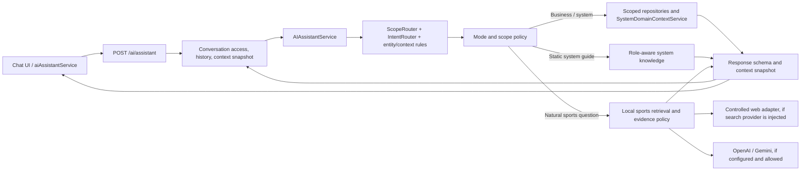
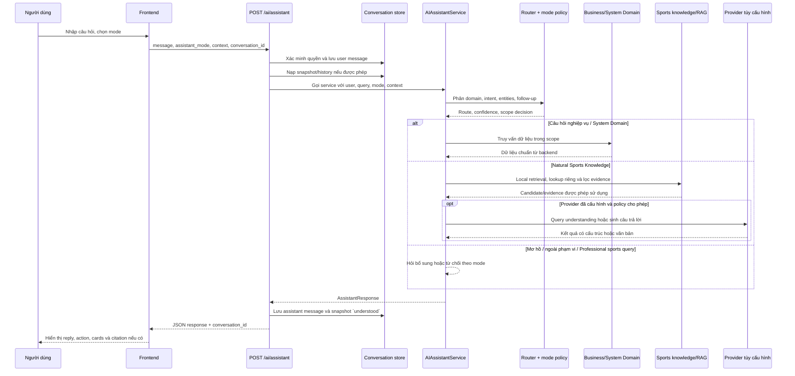
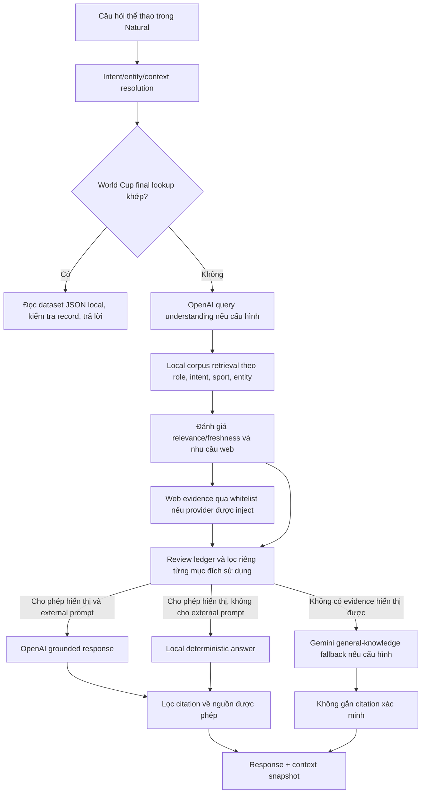

# Báo cáo kiến trúc và pipeline xử lý của Trợ lý AI SportHub

> **Bản đối chiếu source: 27/10/2026.** Tài liệu mô tả code hiện có trong workspace, không khẳng định mọi provider ngoài đang được cấu hình hoặc mọi luồng đã được nghiệm thu production. Khi cấu hình triển khai khác code mặc định, cần ghi rõ cấu hình thực tế.

## Tóm tắt

Trợ lý AI SportHub là một pipeline điều phối có kiểm soát trong backend FastAPI. Pipeline kết hợp bộ phân loại intent/entity, chính sách phạm vi theo chế độ, service nghiệp vụ đọc dữ liệu SportHub, kho tri thức nội bộ, các tác vụ LLM giới hạn và bộ định dạng response. Hệ thống **không** chạy vòng lặp agent tự trị, không để LLM tự chọn/call công cụ tùy ý và không giao quyền tạo booking hoặc thanh toán cho LLM.

Trợ lý có hai chế độ:

- **Natural**: hội thoại thân thiện; hỗ trợ nghiệp vụ SportHub và, theo policy, kiến thức thể thao, context nhiều lượt và một số tín hiệu cá nhân hóa.
- **Professional**: tập trung nghiệp vụ SportHub/System Domain và hướng dẫn nội bộ; từ chối nhánh Sports Knowledge; không nạp các profile cá nhân vào xử lý.

Nguồn chuẩn cho giá, lịch trống, booking, thanh toán và dữ liệu tài khoản là backend/database trong phạm vi quyền của người dùng. LLM chỉ tham gia những tác vụ được gọi rõ ràng, với dữ liệu đầu vào được chuẩn bị trước và kết quả được kiểm tra ở backend.

## 1. Phạm vi và thành phần

| Thành phần | Trách nhiệm |
|---|---|
| `Frontend/src/pages/AIAssistantPage.tsx` | Giao diện chat, chọn mode, hiển thị reply/kết quả sân/citation và gửi tiếp context. |
| `Frontend/src/services/aiAssistantService.ts` | Gọi API trợ lý, gửi token và payload hội thoại. |
| `Backend/app/api/routes/ai.py` | Endpoint, xác thực tùy chọn, tạo/đọc hội thoại, lưu message và gọi service. |
| `Backend/app/services/ai_assistant_service.py` | Điều phối chính: context, intent, policy, nhánh nghiệp vụ, tri thức và response. |
| `Backend/app/services/ai_intent_router.py` | Chuẩn hóa văn bản, phân loại intent, trích entity và nhận diện follow-up bằng luật/heuristics. |
| `Backend/app/services/ai_domain_policy.py` | Phân loại domain và quyết định phạm vi/nguồn được dùng theo Natural hoặc Professional. |
| `Backend/app/services/system_domain_context_service.py` | Truy vấn read-only dữ liệu SportHub cho sản phẩm, dịch vụ, tiện ích và đặc điểm cơ sở. |
| `Backend/app/services/rag_guardrail.py`, `knowledge_service.py`, `knowledge_retriever.py` | Kiểm soát intent được tra cứu và truy xuất corpus kiến thức thể thao nội bộ. |
| `Backend/app/services/llm_sports_processor.py`, `ai_provider.py` | Phân tích truy vấn thể thao, sinh câu trả lời theo evidence và gọi provider khi được cấu hình. |
| `Backend/app/services/sports_knowledge_policy*.py`, `sports_knowledge_review_ledger.py` | Kiểm tra metadata, quyết định review và quyền sử dụng evidence theo từng mục đích. |
| `Backend/app/repositories/ai_repository.py`, `Backend/app/models/ai_conversation.py` | Đọc dữ liệu nghiệp vụ theo phạm vi và lưu hội thoại/message. |
| `Backend/app/ai/` | Huấn luyện, tiền xử lý, nạp và đánh giá pipeline dự đoán nhu cầu. |

## 2. Sơ đồ kiến trúc



LLM provider là thành phần phụ trợ được gọi từ một nhánh cụ thể. Quyền truy cập database và thao tác nghiệp vụ vẫn nằm trong API/service/repository; prompt không phải ranh giới bảo mật.

## 3. Luồng xử lý hội thoại



Các bước chính:

1. **Nhận request**: `AssistantRequest` gồm `message`, `assistant_mode`, `context_field_id`, `context` và `conversation_id`. Endpoint cho phép request không đăng nhập đối với hội thoại/câu hỏi công khai; dữ liệu riêng tư vẫn yêu cầu tài khoản và scope hợp lệ.
2. **Quản lý hội thoại**: API tạo hoặc nạp `AIConversation`, xác minh chủ sở hữu nếu hội thoại đã gắn tài khoản, lưu user message rồi mới gọi service. Response và context snapshot được lưu sau khi xử lý xong.
3. **Khôi phục context**: context được gửi rõ ràng sẽ được ưu tiên. `context: null` cho phép dùng snapshot và tối đa 10 message gần đây; `context: {}` là reset tường minh, không nạp snapshot cũ hay history vào lượt xử lý. Lịch sử giúp hiểu follow-up, không được coi là bằng chứng factual.
4. **Chọn mode và làm sạch context**: mode mặc định là `NATURAL`. Professional lọc các trường context về sports entity/topic trước khi route. Natural có thể tải profile riêng theo user hiện tại.
5. **Route và policy**: `ScopeRouter` nhận diện domain tổng quát; `IntentRouter` trả intent, confidence, entities, follow-up, nhu cầu hỏi bổ sung và trạng thái reset. `evaluate_mode_scope` quyết định mode có được vào nhánh đó hay không.
6. **Dispatch**: yêu cầu chuyển đến nhánh nghiệp vụ/System Domain, static system knowledge, Sports Knowledge, hội thoại xã giao, hỏi làm rõ hoặc từ chối.
7. **Tạo response**: backend tạo `AssistantResponse` gồm `reply`, `understood`, `intent`, `classification`, `confidence`, `entities`, `status`, `suggestions`, `venue_results`, `action`, `assistant_mode` và context-reset metadata khi phù hợp.
8. **Lưu kết quả**: API lưu assistant message cùng payload JSON, cập nhật snapshot từ `understood` (loại `conversation_messages` khỏi snapshot) rồi trả `conversation_id` cho client.

## 4. Intent, entity và định tuyến

`AssistantIntent` hiện có 27 intent trong source. Danh sách được nhóm để dễ trình bày; enum trong `ai_intent_router.py` là danh sách chuẩn.

| Nhóm | Intent hiện có |
|---|---|
| Tìm sân và vận hành | `SEARCH_VENUE`, `RECOMMEND_VENUE`, `CHECK_AVAILABILITY`, `RECOMMEND_SLOT`, `GET_VENUE_DETAIL`, `GET_PRODUCTS`, `CREATE_BOOKING`, `GET_BOOKING`, `CANCEL_BOOKING`, `RESCHEDULE_BOOKING`, `OCCUPANCY_INSIGHT`, `PARTNER_APPLICATION_SUPPORT`, `PAYMENT_SUPPORT`, `ACCOUNT_SUPPORT`, `SYSTEM_GUIDE` |
| Kiến thức thể thao | `SPORTS_KNOWLEDGE` |
| Hội thoại và kiểm soát | `GREETING`, `FOLLOW_UP`, `UNCLEAR`, `OUT_OF_SCOPE`, `AI_IDENTITY`, `AI_CAPABILITY`, `THANKS`, `GOODBYE`, `CASUAL`, `ABUSIVE`, `NONSENSE` |

Intent routing chính là deterministic: chuẩn hóa tiếng Việt, luật/keyword/regex, alias, entity resolver và context. Dữ liệu trích được có thể gồm môn thể thao, loại sân, cơ sở/sân, vị trí, ngày, thời gian, mức giá, số người, mã booking, vận động viên, đội/giải đấu, năm, topic và các entity liên quan. Confidence thấp hoặc thiếu trường bắt buộc dẫn đến hỏi làm rõ.

Trong nhánh **Natural Sports Knowledge**, sau khi router đã chọn intent, `LLMSportsQueryProcessor` có thể gọi OpenAI để giải alias, phân giải follow-up và viết lại câu hỏi thành dạng độc lập. Kết quả này chỉ bổ sung/thay đổi cách hiểu của nhánh thể thao; nó không thay thế kiểm tra scope và không điều khiển truy vấn nghiệp vụ tùy ý. Khi provider không khả dụng, nhánh quay về kết quả deterministic.

## 5. Khác biệt giữa hai chế độ

| Năng lực/nguồn | Natural | Professional |
|---|---|---|
| Tìm sân, giá, availability, booking support và System Domain | Có, qua backend với scope hiện hành | Có, qua backend với scope hiện hành |
| Hướng dẫn SportHub/static knowledge | Có | Có |
| Sports Knowledge nội bộ | Có theo intent và evidence policy | Bị từ chối trước World Cup lookup, Sports RAG và web retrieval |
| Approved sports web | Có thể đi qua controlled retriever trong Natural; phụ thuộc search provider được inject/cấu hình | Bị chặn |
| Explicit memory, booking behavior profile, conversation topic profile | Có thể dùng cho tài khoản đã đăng nhập | Không nạp vào xử lý mode này |
| Lối diễn đạt | Hội thoại tự nhiên | Nghiệp vụ, ngắn gọn và định hướng thao tác hệ thống |

Cả hai mode đều phải dùng backend làm nguồn chuẩn cho dữ liệu nghiệp vụ. Việc mode cho phép một nguồn không đồng nghĩa provider hoặc dữ liệu nguồn đó đã cấu hình sẵn ở mọi môi trường.

## 6. Các nhánh xử lý

### 6.1 Nghiệp vụ SportHub và System Domain

- Tìm sân/khung giờ bắt đầu từ `AIRepository` và service availability. Nếu thiếu môn/ngày/giờ cần thiết, assistant trả `NEED_MORE_DATA` thay vì đoán.
- `AIFeatureService.recommend_slots` lọc các cặp sân/slot thực sự còn khả dụng trước khi xếp hạng. OpenAI có thể chọn tối đa ba mục trong danh sách đã cho theo JSON schema; backend bỏ mọi ID không thuộc danh sách đó. Nếu provider lỗi, backend xếp hạng lại theo giờ, giá, rating và ID.
- Kết quả của intent `CREATE_BOOKING` là gợi ý và điều hướng người dùng sang UI để tự kiểm tra/xác nhận. Assistant endpoint không tạo, hủy, đổi booking hoặc ghi payment.
- Tra cứu account/booking/payment/partner status phải dựa trên user hiện tại và repository scope; nếu người dùng chưa đăng nhập, service có thể hướng dẫn đăng nhập thay vì tiết lộ dữ liệu.
- `SystemDomainContextService` đọc dữ liệu về sản phẩm, dịch vụ, tiện ích và đặc điểm sân/cơ sở. Response phân biệt sản phẩm đang được cơ sở cung cấp với mục trong catalog chỉ là gợi ý; dữ liệu catalog không được mô tả thành hàng đang có.
- Professional trả nội dung nghiệp vụ theo dữ liệu backend và deterministic guide. Natural có thể dùng LLM để diễn đạt lại một số câu trả lời từ evidence đã chuẩn bị; LLM không được đổi sự thật nguồn.

### 6.2 Hướng dẫn hệ thống và static knowledge

Các intent hướng dẫn/account/partner/payment đi qua whitelist trong `RAGGuardrail`. Câu hỏi khớp kho `ai_system_knowledge.py` có thể nhận câu trả lời có sẵn và `suggested_action`; kiểm tra role được áp dụng cho mục hướng dẫn bị giới hạn. Khi không có mục phù hợp, một số intent rơi về handler thông tin hiện hữu hoặc hỏi thêm. Đây là kho hướng dẫn hệ thống, tách khỏi dữ liệu động như lịch trống và số tiền booking.

### 6.3 Sports Knowledge — pipeline retrieval và generation



Chi tiết các bước:

1. **Guard mode và lookup riêng**: Professional bị chặn trước nhánh này. Trong Natural, tra cứu kết quả chung kết FIFA World Cup từ JSON local được thử trước Sports RAG. Lookup hiện chỉ khai báo các kỳ 1998–2022; dữ liệu được kiểm tra cấu trúc/đội thắng và là nhánh riêng, chưa dùng Sports Knowledge review ledger.
2. **Hiểu truy vấn**: `SportsContextResolver` và `IntentRouter` giải alias, số áo, nickname, entity/topic và follow-up. OpenAI có thể trả JSON có schema cho bước hiểu/viết lại truy vấn; nếu không có provider thì dùng xử lý deterministic.
3. **Tìm evidence nội bộ**: `KnowledgeRepository` nạp các bảng tri thức Markdown dưới `docs/AI/knowledge/`. `KnowledgeRetriever` áp dụng role, intent, sport, entity và candidate filter; mặc định dùng keyword/fuzzy score, top-K và relevance gate 0.60. Semantic encoder là tùy chọn và `use_semantic=False` mặc định trong constructor hiện tại.
4. **Freshness và web**: `RAGGuardrail` chỉ cho Sports Knowledge Natural đi vào controlled web retriever. Retriever kiểm tra domain whitelist, nội dung liên quan môn thể thao, rumor và freshness. `SportsWebRetriever` hiện mặc định `search_provider=None`; vì vậy web không thực sự thu thập kết quả nếu runtime không inject một search provider. Kiến trúc whitelist không tự chứng minh live web đang bật.
5. **Policy theo mục đích**: Candidate local chưa phải quyền hiển thị hay quyền gửi ra model. Với record có kiểm soát, code xét riêng `retrieve_internal`, `display_answer`, `prompt_llm_external` và `display_citation`. Metadata phải hợp lệ và quyết định trong review ledger phải được xác thực, còn hiệu lực với fingerprint nội dung và đúng purpose. Ledger lỗi/thiếu hoặc key xác thực không sẵn sàng làm cho các quyền review-controlled bị từ chối. Không suy ra rằng mọi record hiện có đã được review/cleared.
6. **Generation**: Nếu được phép gửi evidence ra ngoài, OpenAI có thể viết câu trả lời; server chỉ giữ citation khớp với evidence có `display_citation`. Nếu evidence được phép hiển thị nhưng không được gửi provider, code có thể ráp câu trả lời deterministic tại chỗ. Nếu không có evidence được phép hiển thị, Natural có thể dùng Gemini general-knowledge fallback khi API key/model đã cấu hình; câu này không có citation kiểm chứng và không được gọi là dữ liệu live/đã xác minh. Câu hỏi thời gian thực không có evidence phải nêu giới hạn, không đoán kết quả.
7. **Fallback**: Khi generation thất bại, code thử deterministic answer từ evidence nếu policy cho phép; nếu không thể trả lời an toàn thì trả trạng thái lỗi/thiếu dữ liệu. Chỉ kiểm tra response không rỗng không tương đương với kiểm định factual tự động.

### 6.4 Pipeline cập nhật kho tri thức

Endpoint `POST /ai/knowledge/update` và `GET /ai/knowledge/update/status` yêu cầu `SYSTEM_ADMIN`; job manager ngăn chạy trùng. Pipeline trong service là:

```text
Nguồn evidence hoặc raw item được cung cấp
  → chuẩn hóa thành fact có sport/entity/topic/question/answer/provenance
  → kiểm tra môn, whitelist nguồn, rumor/xác nhận, độ tin cậy và metadata
  → bỏ qua trùng / từ chối xung đột / upsert record hợp lệ
  → cập nhật retriever index; có thể persist Markdown nếu được yêu cầu
  → trả summary trạng thái job
```

Lệnh update tự nó không có quyền cấp `approved_uses` hoặc tạo review approval. Việc thu thập từ web vẫn phụ thuộc `search_provider`; request có thể nhận `raw_items` làm đầu vào đã thu thập sẵn. Đây là job cập nhật tri thức, không phải thao tác tự động cho mọi câu hỏi chat.

## 7. Context và cá nhân hóa

- `AIConversation`/`AIMessage` lưu nội dung hội thoại và payload response. Endpoint đọc hội thoại xác minh chủ sở hữu nếu hội thoại thuộc user đã đăng nhập.
- Recent conversation history dùng để giải quyết đại từ/follow-up; sports query history loại phần assistant trước đó khỏi context đưa sang provider vì câu trả lời trước có thể chưa được kiểm chứng.
- `UserAIMemoryService` chỉ trích xuất một số phát biểu tường minh thuộc nhóm được hỗ trợ, như môn thường chơi, vận động viên yêu thích, phong cách trả lời và khu vực tìm sân; service loại nhiều mẫu dữ liệu nhạy cảm. User có thể xem/xóa memory qua endpoint yêu cầu JWT.
- Natural có thể nạp explicit memory, `BookingBehaviorProfileService` từ booking đủ điều kiện trong cửa sổ 180 ngày và `ConversationTopicProfileService` từ câu hỏi lặp lại trong 180 ngày. Profile hành vi/chủ đề là tín hiệu suy luận, không phải xác nhận sở thích hoặc sports evidence.
- Các profile chỉ được truy xuất theo user ID hiện tại. Chúng không được dùng làm citation hay bằng chứng thể thao; Professional không nạp chúng.

## 8. Tác vụ AI ngoài chat và pipeline ML

| Tác vụ/API | Pipeline và giới hạn |
|---|---|
| `POST /ai/recommend-slots` | Backend lấy available pairs → dựng lựa chọn hợp lệ → OpenAI trả các ID và lý do theo JSON schema → backend xác minh ID thuộc allowlist; provider lỗi thì dùng xếp hạng rule-based. Không ghi booking. |
| `GET /ai/occupancy-summary` | OWNER-scoped `AnalyticsService` tính số liệu trước → OpenAI sinh nhận xét/gợi ý có schema → backend kiểm tra slot ID và chặn nội dung sửa số hoặc tuyên bố đã áp dụng khuyến mãi; fallback dựng từ analytics. |
| `POST /ai/generate-booking-message` | Backend xác minh sự kiện với booking và đóng băng facts → LLM chỉ sinh lead/closing → validator loại câu copy chứa dữ kiện giao dịch → fallback dùng template. |
| Demand prediction / `POST /ai/predict-demand` | Lấy hoặc dựng features → nạp pipeline scikit-learn đã huấn luyện từ artifact `joblib` → trả nhãn, xác suất và giải thích. Model loader kiểm tra phiên bản scikit-learn và feature contract. Endpoint insights giới hạn OWNER scope; đây là inference, không train trong request. |
| `GET /ai/recommendations` | Lọc sân/slot đang trống → dự đoán demand bằng pipeline ML → xếp hạng bằng công thức kết hợp giá và demand level; model không tạo slot/availability mới. |
| `GET /ai/customer-recommendations` | Gợi ý sân qua service riêng; tùy trạng thái đăng nhập có thể dùng customer ID, nhưng kết quả vẫn lấy từ dữ liệu nền tảng. |

OpenAI provider dùng cấu hình `OPENAI_API_KEY`, `OPENAI_MODEL`, timeout và retry từ environment; các tác vụ cấu trúc dùng JSON Schema nghiêm ngặt. Gemini được cấu hình riêng (`GEMINI_API_KEY`, `GEMINI_MODEL`) và trong nhánh trợ lý nêu trên chỉ là fallback general knowledge của Natural. Không ghi API key hoặc giả định một giá trị model mặc định là model đang chạy ở production.

Khi provider ngoài đã cấu hình và nhánh tương ứng được gọi, payload có thể chứa câu hỏi hiện tại, một phần context/lịch sử người dùng, sports evidence đã được phép gửi, hoặc dữ liệu nghiệp vụ đã được chuẩn bị để xếp hạng/tóm tắt. Riêng `write_booking_message_copy` gửi loại sự kiện và hướng dẫn sinh câu chữ; các transaction facts được ghép vào message ở backend, không lấy từ nội dung do model sinh.

## 9. Quyền, tính toàn vẹn và giới hạn

- `get_optional_current_user` cho phép câu hỏi công khai/hội thoại ẩn danh; dữ liệu booking, payment, hồ sơ và báo cáo vẫn phải qua đăng nhập, role và scope trong service/repository.
- `AIRepository.scope_for_user`, ownership checks và endpoint dependencies có trách nhiệm ngăn truy vấn vượt tenant. Context hoặc nội dung người dùng gửi lên không phải bằng chứng cấp quyền.
- Assistant chat là read/guidance flow. Nó có thể trả link/action để người dùng tiếp tục trên UI; người dùng xác nhận thao tác nghiệp vụ ở chức năng tương ứng.
- Giá, availability, booking và số liệu phải bắt nguồn từ database/backend; dữ liệu LLM không thể override candidate hay số liệu đã tính.
- Citation chỉ xuất hiện khi câu trả lời có evidence với quyền citation phù hợp. Không phải mọi câu trả lời AI đều có citation.
- Trợ lý không có autonomous tool loop, nhưng một số nhánh Natural gọi LLM để hiểu truy vấn hoặc viết câu trả lời. Provider có thể lỗi/không cấu hình; từng nhánh có deterministic fallback hoặc trả lỗi phù hợp.
- Dữ liệu lịch sử hội thoại là context, không phải nguồn xác minh factual. Gemini general-knowledge fallback là câu trả lời không có nguồn kiểm chứng.

## 10. Giới hạn kỹ thuật phát hiện khi đối chiếu source

1. `SportsWebRetriever` khởi tạo mặc định không có `search_provider`, và `retrieve_evidence()` trả danh sách rỗng nếu không được inject. Cần cấu hình/inject adapter thực tế trước khi mô tả web retrieval là đang hoạt động.
2. Freshness helpers trong `sports_web_retriever.py` và `rag_guardrail.py` có mặc định ngày `2026-09-17`; call path trợ lý hiện gọi evaluator mà không truyền ngày hiện tại. Vì vậy kết quả freshness theo ngày cần được xem xét/cập nhật trước khi dùng như kiểm tra live tại ngày báo cáo.
3. `KnowledgeRetriever` dùng semantic similarity tùy chọn nhưng constructor hiện đặt `use_semantic=False`; không mô tả dense vector search là chế độ mặc định. Kho này không tự chứng minh đang dùng vector database chuyên dụng.
4. Model prediction phụ thuộc artifact/metadata/metrics và phiên bản sklearn khớp. Nếu artifact không sẵn sàng hoặc contract lệch, API trả lỗi `503` thay vì bảo đảm luôn có dự báo.
5. Gemini general-knowledge fallback không có citation và không xác minh dữ liệu biến động theo thời gian thực. World Cup JSON lookup chỉ có các trận chung kết được khai báo đến năm 2022.

## 11. Bằng chứng kiểm thử và giới hạn của số liệu

Trong ghi nhận trước của workspace có một lần chạy regression mục tiêu ngày **27/10/2026** cho `test_sports_knowledge_policy_runtime.py`, `test_sports_knowledge_policy.py` và `test_ai_intent_router.py`: **168 passed, 24 subtests passed** bằng provider mock. Đây không phải toàn bộ backend/frontend suite và không kiểm tra provider thật. Lần cập nhật tài liệu này không chạy lại test; trước khi trích dẫn kết quả, đối chiếu với log/artifact của lần chạy tương ứng.

Không dùng các tuyên bố “độ chính xác 100%”, “hallucination bằng 0” hoặc test count của checkpoint cũ làm kết luận runtime. `AI_EVALUATION.md` lưu các đánh giá theo bộ dữ liệu/lần chạy; cần nêu ngày, phạm vi và điều kiện provider khi dẫn số liệu.

## 12. Tài liệu và vị trí source

| Chủ đề | Tài liệu/source |
|---|---|
| Kiến trúc trợ lý AI và cập nhật runtime | [`AI/AI_ARCHITECTURE.md`](AI/AI_ARCHITECTURE.md) |
| Kết quả đánh giá theo lần chạy | [`AI_EVALUATION.md`](AI_EVALUATION.md) |
| Hợp đồng endpoint AI | [`API.md`](API.md), [`../Backend/app/api/routes/ai.py`](../Backend/app/api/routes/ai.py), [`../Backend/app/schemas/ai.py`](../Backend/app/schemas/ai.py) |
| Orchestration và pipeline chat | [`../Backend/app/services/ai_assistant_service.py`](../Backend/app/services/ai_assistant_service.py) |
| Intent/entity | [`../Backend/app/services/ai_intent_router.py`](../Backend/app/services/ai_intent_router.py), [`../Backend/app/services/ai_sports_resolver.py`](../Backend/app/services/ai_sports_resolver.py) |
| Scope/mode policy | [`../Backend/app/services/ai_domain_policy.py`](../Backend/app/services/ai_domain_policy.py) |
| Sports Knowledge/RAG/evidence | [`../Backend/app/services/rag_guardrail.py`](../Backend/app/services/rag_guardrail.py), [`../Backend/app/services/knowledge_retriever.py`](../Backend/app/services/knowledge_retriever.py), [`../Backend/app/services/sports_knowledge_policy_enforcement.py`](../Backend/app/services/sports_knowledge_policy_enforcement.py), [`../Backend/app/services/sports_knowledge_review_ledger.py`](../Backend/app/services/sports_knowledge_review_ledger.py) |
| LLM providers và sports response | [`../Backend/app/services/llm_sports_processor.py`](../Backend/app/services/llm_sports_processor.py), [`../Backend/app/services/ai_provider.py`](../Backend/app/services/ai_provider.py) |
| World Cup lookup và corpus | [`../Backend/app/services/world_cup_lookup.py`](../Backend/app/services/world_cup_lookup.py), [`AI/knowledge/`](AI/knowledge/) |
| AI personalization | `user_ai_memory_service.py`, `booking_behavior_profile_service.py`, `conversation_topic_profile_service.py` trong `Backend/app/services/` |
| Demand prediction | `Backend/app/ai/inference/`, `Backend/app/ai/preprocessing/`, `Backend/app/ai/saved_models/` |

---

*Tài liệu này là báo cáo kiến trúc hiện hành theo source đã đọc ngày 27/10/2026. Khi thay đổi route, mode policy, provider wiring, evidence policy hoặc pipeline dữ liệu, cập nhật lại sơ đồ và các giới hạn liên quan; không chép nguyên checkpoint lịch sử thành mô tả hiện tại.*
