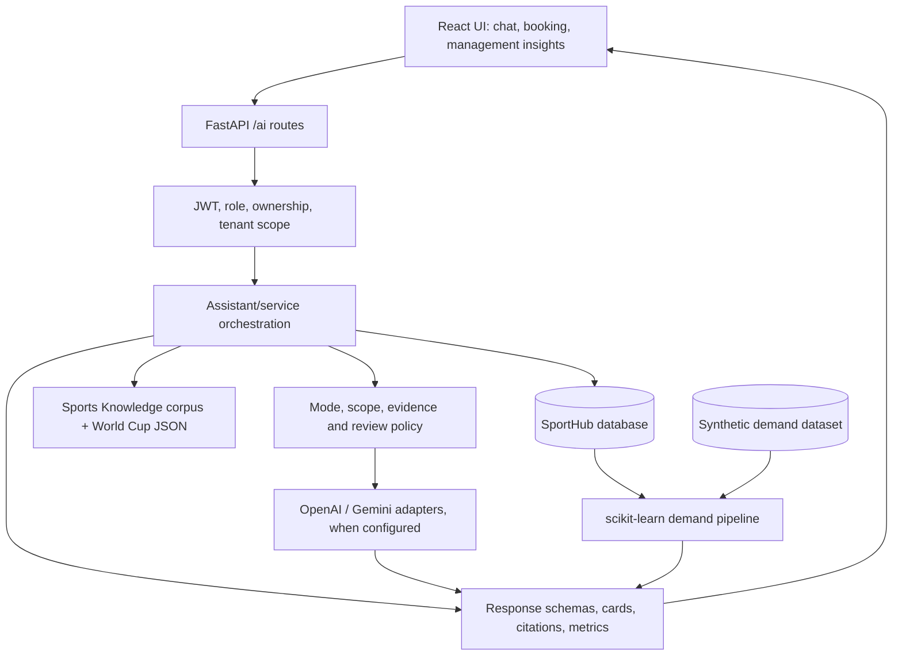
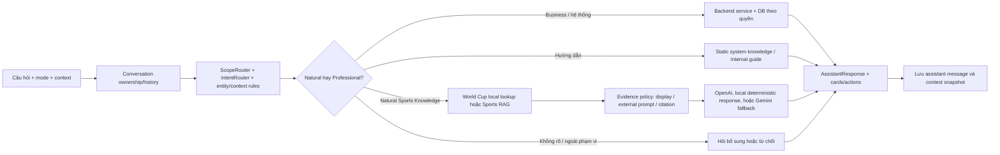
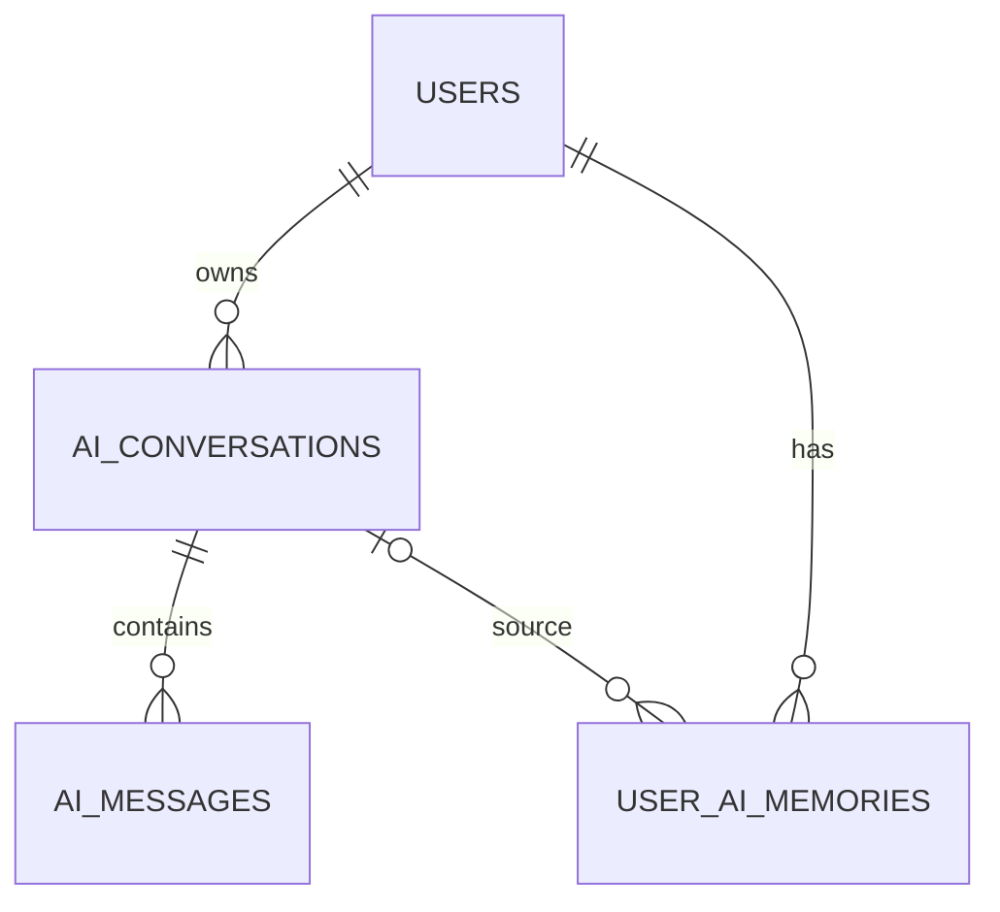
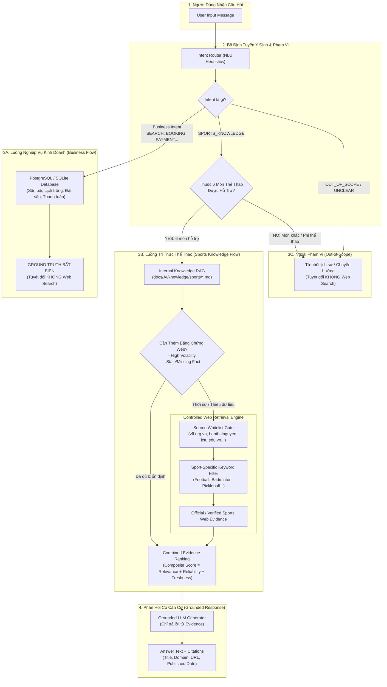

# Báo cáo tổng hợp phân hệ AI SportHub AI

> **Bản đồng bộ theo source: 27/10/2026.** Tài liệu này tổng hợp toàn bộ chức năng AI/ML hiện có trong SportHub AI: trợ lý hội thoại, tìm/gợi ý sân, dự báo nhu cầu, phân tích công suất, sinh nội dung booking, gợi ý sân cá nhân hóa và quản lý kho Sports Knowledge. Đây là mô tả code và artifact trong workspace; việc một provider ngoài chạy được còn phụ thuộc cấu hình môi trường.

## Tóm tắt điều hành

AI trong SportHub AI là tập hợp nhiều nhánh được backend điều phối, không phải một mô hình duy nhất. Các nhánh gồm:

1. **Trợ lý hội thoại**: hiểu intent/context, trả lời nghiệp vụ từ backend, hướng dẫn hệ thống và hỗ trợ Sports Knowledge theo policy.
2. **Xếp hạng slot**: backend xác minh availability trước; LLM có thể chọn thứ tự trong danh sách hợp lệ.
3. **Gợi ý sân cho khách**: service chấm điểm rule-based theo rating, độ phổ biến, lịch sử đặt và slot trống; không gọi LLM.
4. **Phân tích công suất**: analytics tính số liệu có scope OWNER; LLM chỉ viết tóm tắt/gợi ý, backend kiểm tra kết quả.
5. **Sinh lời nhắn booking**: sự kiện và facts lấy từ booking; LLM chỉ sinh lời dẫn/lời kết, backend tự ghép dữ kiện.
6. **Dự báo nhu cầu**: pipeline scikit-learn đã huấn luyện sẵn, dùng features lịch/giá/booking để phân loại `LOW`, `MEDIUM`, `HIGH`.
7. **Sports Knowledge**: tra cứu corpus nội bộ, policy evidence, lookup World Cup local riêng và pipeline quản trị cập nhật tri thức.

LLM không phải nguồn chuẩn cho giá, lịch, booking, payment hay báo cáo. Các thao tác giao dịch vẫn do nghiệp vụ backend xử lý sau khi người dùng thực hiện/xác nhận trong ứng dụng.

## 1. Kiến trúc tổng thể



Các thành phần nằm chủ yếu tại `Backend/app/services/`, `Backend/app/ai/`, `Backend/app/api/routes/ai.py` và `Frontend/src/pages/AIAssistantPage.tsx`. Quyền thực tế được enforce ở API/service/repository; việc gửi context hoặc prompt không cấp quyền đọc dữ liệu.

## 2. Danh mục năng lực AI hiện có

| Năng lực | API/chức năng | Kỹ thuật chính | Nguồn dữ liệu và quyền |
|---|---|---|---|
| Trợ lý SportHub | `POST /ai/assistant` | Rule-based intent/entity, scope policy, service dispatch; LLM/RAG ở các nhánh được phép | Context hội thoại; dữ liệu nghiệp vụ qua repository theo user/tenant; Sports Knowledge theo mode và evidence policy |
| Gợi ý khung giờ | `POST /ai/recommend-slots` | Availability filtering + LLM JSON ranking; deterministic fallback | Slot thật từ `AvailabilityService`; endpoint yêu cầu user đăng nhập |
| Gợi ý sân cá nhân hóa | `GET /ai/customer-recommendations` | Heuristic scoring, không dùng LLM/ML model | Rating, số booking, slot hôm nay và lịch sử user nếu có; hỗ trợ ẩn danh |
| Phân tích công suất | `GET /ai/occupancy-summary` | Owner-scoped analytics + LLM summary có schema + validation/fallback | Booking/payment/slot trong phạm vi OWNER |
| Sinh nội dung booking | `POST /ai/generate-booking-message` | LLM tạo lead/closing có schema; backend khóa facts và ghép nội dung | Booking của user được phép truy cập; sự kiện phải khớp trạng thái booking |
| Dự báo nhu cầu | `POST /ai/predict-demand`, `GET /ai/model-metrics`, `/ai/demand-overview`, `/ai/recommendations` | scikit-learn inference và rule-based ranking | Feature từ request và database; insights giới hạn OWNER scope |
| Sports Knowledge | Nhánh trong `/ai/assistant` | Intent/entity resolution, local retrieval, evidence policy, OpenAI response hoặc local/Gemini fallback | Corpus `docs/AI/knowledge/`; Professional bị chặn nhánh này |
| Cập nhật kho tri thức | `POST /ai/knowledge/update`, `GET /ai/knowledge/update/status` | Fact normalization, validation, upsert/index, job summary | SYSTEM_ADMIN; nguồn whitelist hoặc raw items đầu vào |
| Giọng nói trên UI | Mic và đọc câu trả lời tại `AIAssistantPage` | Browser Web Speech API | Phụ thuộc hỗ trợ/voice có sẵn trong trình duyệt/thiết bị; không phải model backend |

## 3. Trợ lý hội thoại và luồng xử lý

Trợ lý chi tiết được mô tả tại [`AI_ASSISTANT_ARCHITECTURE_REPORT.md`](AI_ASSISTANT_ARCHITECTURE_REPORT.md). Tóm tắt pipeline hiện hành:



### Hai chế độ xử lý

| Natural | Professional |
|---|---|
| Hỗ trợ nghiệp vụ SportHub, hội thoại tự nhiên và Sports Knowledge theo policy. Có thể nạp explicit memory, booking behavior profile và conversation topic profile của user hiện tại. | Tập trung nghiệp vụ SportHub/System Domain và hướng dẫn nội bộ. Từ chối Sports Knowledge trước World Cup lookup, RAG và web; không nạp các profile cá nhân. |

### Các lớp hiểu yêu cầu

- `ScopeRouter` phân loại domain tổng quát; `IntentRouter` deterministic hóa intent, confidence, entities, follow-up, context reset và nhu cầu hỏi bổ sung.
- Source hiện có **27 intent**, gồm nghiệp vụ sân/booking/payment/account, `SPORTS_KNOWLEDGE`, hội thoại, unclear, out-of-scope, abusive và nonsense. Danh sách đầy đủ nằm trong source enum và báo cáo assistant.
- Trong Natural Sports Knowledge, OpenAI có thể được dùng sau intent routing để phân giải alias/entity, follow-up và viết lại câu hỏi dạng độc lập. Nếu provider không khả dụng, code dùng kết quả deterministic.
- `context: null` cho phép khôi phục snapshot/lịch sử hội thoại; `context: {}` reset rõ ràng. Lịch sử giúp hiểu câu nối tiếp nhưng không phải bằng chứng factual.

## 4. Các pipeline AI/ML theo chức năng

### 4.1 Xếp hạng slot còn trống

```text
Yêu cầu CUSTOMER/OWNER
  → kiểm tra môn/ngày/giờ/thời lượng
  → AvailabilityService truy vấn slot thật còn trống
  → lọc loại sân, giá, khu vực và chuỗi slot liên tiếp
  → gửi nhu cầu + danh sách candidate cho OpenAI (JSON Schema)
  → backend chỉ nhận ID nằm trong allowlist candidate
  → trả tối đa 3 lựa chọn hoặc dùng fallback xếp hạng theo giờ/giá/rating
```

LLM không được phép tự tạo sân/slot hoặc xác nhận booking. Nếu không có candidate hợp lệ, response là `NO_AVAILABLE_SLOT`; nếu thiếu input, là `NEED_MORE_DATA`.

### 4.2 Gợi ý sân cho CUSTOMER

`CustomerRecommendationService` lấy các sân available, chỉ giữ cơ sở đang active/approved khi có facility, rồi lấy slot trống của ngày hiện tại. Với user có lịch sử booking đủ điều kiện, service cộng điểm cho môn, địa điểm, khung giờ và khoảng giá đã đặt; nếu không có lịch sử, xếp theo rating và độ phổ biến. Kết quả trả `strategy` là `booking_history` hoặc `popular_and_high_rated`. Đây là logic rule-based, không phải LLM, và không dự đoán booking chắc chắn sẽ xảy ra.

### 4.3 Phân tích công suất và gợi ý ưu đãi

```text
OWNER + khoảng ngày / sân
  → AnalyticsService giới hạn dữ liệu theo owner_id
  → tính giờ khai thác, giờ được đặt, công suất, doanh thu/refund và slot cao/thấp điểm
  → nếu có low-demand slots: gửi số liệu cho OpenAI để viết summary/promotions theo schema
  → backend kiểm tra summary không sửa số, slot ID thuộc dữ liệu đầu vào,
    promotion không tuyên bố đã được áp dụng
  → lỗi/không có slot thấp điểm: trả summary/gợi ý deterministic
```

LLM không thay đổi giá hoặc tạo chương trình khuyến mãi; số liệu được tính trước bởi backend.

### 4.4 Sinh lời nhắn booking

`BookingMessageService` truy vấn booking qua quyền của user, kiểm tra event có khớp trạng thái/payment hiện tại hay không, rồi tạo facts bất biến ở backend. Provider chỉ nhận loại sự kiện và hướng dẫn tạo `lead`/`closing`; service ghép facts vào giữa, lọc câu sinh có số tiền/mã booking/trạng thái hoặc nội dung nghiệp vụ trái phép và dùng template khi provider lỗi.

### 4.5 Demand prediction: huấn luyện và inference

**Huấn luyện offline** trong `Backend/app/ai/training/train_model.py`:

```text
Dataset synthetic booking_demand.csv
  → kiểm tra schema, kiểu dữ liệu, range, label và loại duplicate
  → stratified train/test split 80/20 (random_state=42)
  → preprocessing: impute + OneHotEncoder cho sport_type,
    impute + StandardScaler cho feature số
  → huấn luyện Decision Tree, Random Forest và Logistic Regression
  → chọn model theo weighted F1, sau đó accuracy
  → lưu joblib pipeline + metrics.json + model_metadata.json
```

Target gồm `LOW`, `MEDIUM`, `HIGH`; 8 features là `sport_type`, `day_of_week`, `start_hour`, `price`, `month`, `is_weekend`, `previous_booking_count`, `field_capacity`. Nếu dataset mặc định chưa có, script có thể sinh dữ liệu mô phỏng seed cố định; dataset đó được tạo theo công thức/heuristic phục vụ học tập, không phải lịch sử thị trường thực.

**Inference**:

```text
OWNER request / candidate slot
  → lấy field capacity và booking count gần đây từ database nếu thiếu input
  → build_feature_record
  → model_loader kiểm tra metadata, phiên bản sklearn và feature contract
  → nạp demand_pipeline.joblib, trả class + probabilities + explanation
  → demand recommendations kết hợp nhãn model với rule-based price score
```

Artifact hiện có trong workspace:

| Trường | Giá trị artifact |
|---|---|
| Model | Random Forest, `demand-rf-v1` |
| Trained at | 05/08/2026 (UTC) |
| Dataset | Synthetic, 2,399 dòng hợp lệ; train 1,919 / test 480 |
| Accuracy / precision / recall / weighted F1 | 0.8250 / 0.8260 / 0.8250 / 0.8252 |
| sklearn / feature contract | 1.9.0; 8 features nêu trên |

Các metric này đo trên test split của dataset synthetic. Không dùng chúng làm bằng chứng rằng model đã đạt cùng chất lượng trên booking thật. Nếu artifact thiếu hoặc version/feature contract không khớp, endpoint trả `503`.

## 5. Sports Knowledge, RAG và vòng đời tri thức

### Tra cứu và trả lời

1. Professional guard từ chối Sports Knowledge trước mọi lookup/retrieval.
2. Natural thử World Cup finals lookup từ JSON local cho các năm được lưu (1998–2022); đây là nhánh deterministic riêng, chưa qua Sports Knowledge review ledger.
3. Câu hỏi khác có thể qua entity/context resolution, OpenAI query understanding (nếu cấu hình), rồi local corpus retrieval trong `docs/AI/knowledge/` theo role/intent/sport/entity.
4. `KnowledgeRetriever` mặc định dùng keyword/fuzzy scoring, top-K và relevance threshold 0.60. Semantic encoder là tùy chọn; constructor hiện mặc định `use_semantic=False`.
5. Candidate retrieval không tự cấp quyền sử dụng. Code tách quyết định cho `retrieve_internal`, `display_answer`, `prompt_llm_external` và `display_citation`; record có kiểm soát cần metadata hợp lệ và review ledger ký/xác thực đúng fingerprint, version và purpose.
6. Khi được phép, OpenAI có thể sinh câu trả lời từ evidence; backend chỉ giữ citation thuộc nguồn được phép. Nếu chỉ được hiển thị tại chỗ, code có thể tạo câu trả lời deterministic. Khi không có evidence được phép hiển thị, Natural có thể dùng Gemini general-knowledge fallback nếu được cấu hình; câu đó không citation kiểm chứng và không phải tra cứu live.

### Cập nhật kho tri thức

Endpoint quản trị yêu cầu `SYSTEM_ADMIN`; job manager chặn job trùng. Pipeline nhận raw item hoặc evidence → chuẩn hóa fact/provenance → kiểm tra môn trong phạm vi, nguồn whitelist, rumor, độ tin cậy và trường bắt buộc → skip duplicate/reject conflict/upsert → cập nhật index và tùy chọn ghi Markdown → trả summary job. Pipeline cập nhật không tự tạo quyền review hoặc `approved_uses`.

**Giới hạn triển khai hiện tại:** `SportsWebRetriever` mặc định có `search_provider=None`, nên không thu thập web nếu môi trường chưa inject adapter tìm kiếm. Các hàm freshness/RAG có ngày mặc định `2026-09-17`, và call path hiện gọi evaluator không truyền ngày hiện tại; cần cập nhật phần này trước khi xem kết quả freshness là đánh giá live theo ngày chạy.

## 6. LLM providers và cấu hình

| Provider | Vai trò trong source | Cấu hình |
|---|---|---|
| OpenAI (`OpenAIProvider`, alias `StructuredAIProvider`) | Sports query understanding, một số response Natural, xếp hạng slot, tóm tắt occupancy, booking message | `OPENAI_API_KEY`, `OPENAI_MODEL`, `AI_PROVIDER_TIMEOUT_SECONDS`, `AI_PROVIDER_MAX_RETRIES` |
| Gemini (`GeminiTextProvider`) | Fallback general-knowledge cho Sports Knowledge trong Natural khi không có evidence hiển thị được | `GEMINI_API_KEY`, `GEMINI_MODEL`, timeout chung |
| scikit-learn pipeline | Dự báo nhu cầu, chạy local artifact inference | `joblib` artifact + metadata/metrics trong `Backend/app/ai/saved_models/` |

Các tác vụ output có cấu trúc dùng JSON Schema nghiêm ngặt và backend kiểm tra output lần nữa. Sports answer là text và citation được lọc từ evidence; việc dùng prompt/evidence không tương đương kiểm chứng factual hoàn toàn. Model thực tế do environment quyết định; không ghi giá trị `.env.example` thành model chắc chắn đang chạy.

Khi provider ngoài được gọi, payload có thể chứa câu hỏi, một phần context/lịch sử, evidence đã được phép gửi, hoặc dữ liệu đã chuẩn bị để xếp hạng/tóm tắt. API key không được ghi vào log. Profile cá nhân không phải sports evidence; việc sử dụng và mode được giới hạn riêng trong assistant.

## 7. API, quyền và bảo vệ dữ liệu

| Endpoint | Quyền chính |
|---|---|
| `POST /ai/assistant` | JWT tùy chọn; hội thoại đã gắn user chỉ user đó truy cập; dữ liệu riêng tư vẫn yêu cầu auth/scope |
| `GET /ai/conversations*` | Yêu cầu đăng nhập; kiểm tra conversation ownership |
| `GET/DELETE /ai/memories*` | Yêu cầu đăng nhập; chỉ memory của user hiện tại |
| `POST /ai/recommend-slots` | Yêu cầu đăng nhập; role hiện hành là CUSTOMER/OWNER |
| `GET /ai/customer-recommendations` | JWT tùy chọn; personalized theo user nếu có quyền/ID phù hợp |
| `GET /ai/occupancy-summary` | OWNER; giới hạn facility theo owner |
| Demand endpoints | OWNER; `DemandPredictionService.for_user()` gắn repository vào owner scope |
| `POST /ai/generate-booking-message` | User đăng nhập; booking phải truy cập được và event khớp trạng thái |
| `/ai/knowledge/update*` | SYSTEM_ADMIN |

Backend là authority cho giá, availability, booking facts, occupancy và user scope. Assistant chat không tự ghi giao dịch; LLM không được phép tạo slot thay candidate, tự cập nhật giá hoặc tự áp dụng khuyến mãi.

## 8. Đánh giá hiện có và cách dẫn số liệu

### Demand model artifact

Artifact hiện lưu weighted F1 0.8252 và các chỉ số tại mục 4.4. Dataset synthetic tạo nhãn theo công thức mô phỏng; đây là đánh giá nội bộ trên holdout từ cùng nguồn sinh dữ liệu, không phải thử nghiệm thực địa.

### Assistant regression

[`AI_EVALUATION.md`](AI_EVALUATION.md) ghi nhận regression mục tiêu ngày **27/10/2026**: 168 passed và 24 subtests passed trên policy/runtime Sports Knowledge và IntentRouter, với provider mock. Đây không phải full backend/frontend suite, không xác minh API provider thật và không chứng minh hệ thống không lỗi.

Các bảng NLU cũ dựa trên “19 intents”, các metric/date cũ hoặc tuyên bố “100% chính xác/hallucination bằng 0” đã không còn là mô tả runtime hiện tại. Khi viết báo cáo, ghi rõ nguồn, ngày, bộ dữ liệu, kích thước test và việc provider là mock hay thật.

## 9. Giới hạn hiện tại và hướng cải thiện

- **Sports web chưa được wiring mặc định**: cần adapter `search_provider` thật, kiểm tra nguồn/dữ liệu và test tích hợp trước khi tuyên bố có web retrieval trực tiếp.
- **Freshness date tĩnh**: truyền ngày hiện tại theo timezone cấu hình hoặc dùng clock runtime thay vì mặc định 17/09/2026.
- **Dataset demand là synthetic**: cần thu thập dữ liệu booking thật đã khử định danh, xác định định nghĩa nhãn nhu cầu và đánh giá temporal/generalization trước khi dùng để đưa ra quyết định vận hành.
- **Semantic retrieval chưa bật mặc định**: đánh giá coverage/relevance corpus hiện tại; chỉ bật embedding khi dependency, latency, index và bộ đo chất lượng được kiểm soát.
- **Gemini fallback không có citation và không kiểm tra live facts**: UI/report cần phân biệt câu trả lời dựa trên evidence với câu trả lời kiến thức nền.
- **Coverage test có phạm vi hẹp**: duy trì regression riêng cho business, ownership, provider failure, RAG rights, memory/context, UI và ML artifact compatibility.
- **Giọng nói phụ thuộc browser**: Web Speech API và voice có sẵn khác nhau theo trình duyệt/thiết bị; đây không phải dịch vụ speech backend do SportHub quản lý.

Không được diễn đạt các guardrail như bảo đảm “không thể hallucinate”. Mô tả chính xác là backend giới hạn nguồn dữ liệu, kiểm tra quyền và xác thực một số đầu ra; vẫn có giới hạn provider, dữ liệu và kiểm thử.

## 10. Bản đồ source và tài liệu chuyên sâu

| Nội dung | Vị trí |
|---|---|
| Chi tiết kiến trúc, pipeline chat, mode và Sports RAG | [`AI_ASSISTANT_ARCHITECTURE_REPORT.md`](AI_ASSISTANT_ARCHITECTURE_REPORT.md), [`AI/AI_ARCHITECTURE.md`](AI/AI_ARCHITECTURE.md) |
| Kết quả thực nghiệm trợ lý | [`AI_EVALUATION.md`](AI_EVALUATION.md) |
| Endpoint và request/response | [`API.md`](API.md), `Backend/app/api/routes/ai.py`, `Backend/app/schemas/ai.py` |
| Router/policy/orchestration | `Backend/app/services/ai_intent_router.py`, `ai_domain_policy.py`, `ai_assistant_service.py` |
| Gợi ý slot, occupancy, customer recommendation, booking copy | `Backend/app/services/ai_feature_service.py`, `analytics_service.py`, `customer_recommendation_service.py`, `booking_message_service.py` |
| Sports corpus, retrieval, policy, web và update pipeline | `Backend/app/services/knowledge_*`, `sports_knowledge_*`, `sports_web_retriever.py`; `docs/AI/knowledge/` |
| Demand train/inference/evaluation | `Backend/app/ai/datasets/`, `preprocessing/`, `training/`, `inference/`, `evaluation/`, `saved_models/` |
| Trợ lý giao diện và speech hooks | `Frontend/src/pages/AIAssistantPage.tsx`, `Frontend/src/hooks/useSpeechRecognition.ts`, `useSpeechSynthesis.ts` |

---

*Cập nhật tiếp tài liệu này khi thêm/bỏ API AI, đổi model/feature contract, nối provider web, thay evidence policy hoặc thay đổi dữ liệu huấn luyện. Source code và artifact có ngày tạo là căn cứ để xác minh các mô tả và metric.*

## 11. Cơ sở dữ liệu và lưu trữ phục vụ AI

### 11.1 Các bảng AI chuyên biệt

| Bảng | Cột và ràng buộc | Mục đích/liên kết |
|---|---|---|
| `ai_conversations` | `id` PK; `conversation_id` UUID string, unique/index; `user_id` nullable FK → `users.id` (`ON DELETE CASCADE`); `title`; `context_snapshot` JSON; `created_at`; `updated_at` | Một hội thoại có thể ẩn danh (`user_id=NULL`) hoặc gắn tài khoản; lưu snapshot hiểu yêu cầu để phục hồi lượt sau. |
| `ai_messages` | `id` PK; `conversation_id` FK → `ai_conversations.id` (`ON DELETE CASCADE`, index); `role` (`user`/`assistant`); `content` TEXT; `payload` JSON nullable; `created_at` | Nhiều message thuộc một conversation; assistant payload giữ response có cấu trúc, card, intent và metadata. |
| `user_ai_memories` | `id` PK; `user_id` FK → `users.id` (`ON DELETE CASCADE`, index); `memory_type`; `memory_key`; `value`; `is_active`; `source_conversation_id` nullable FK → `ai_conversations.id` (`ON DELETE SET NULL`); `created_at`; `updated_at`; UNIQUE(`user_id`,`memory_key`) | Lưu các preference được user nói tường minh; chỉ user sở hữu được xem/xóa memory. |

Quan hệ rút gọn:



`AIConversation` và `AIMessage` được khai báo trong [`Backend/app/models/ai_conversation.py`](../Backend/app/models/ai_conversation.py); `UserAIMemory` nằm trong [`Backend/app/models/user_ai_memory.py`](../Backend/app/models/user_ai_memory.py). Xóa conversation xóa messages theo cascade; xóa conversation là nguồn của memory sẽ đặt `source_conversation_id=NULL`, không xóa memory; xóa user sẽ cascade hội thoại và memory của user.

### 11.2 AI không có bảng SQL riêng cho mọi dữ liệu

`KnowledgeEntry` hiện là dataclass, **không phải ORM model và không phải bảng `knowledge_entries` trong database**. `KnowledgeRepository` đọc các bảng Markdown trong `docs/AI/knowledge/`, parse thành entries trong process và `KnowledgeRetriever` tạo index trong bộ nhớ. Vì thế:

- Thay đổi corpus file Markdown và thay đổi review ledger là hai việc riêng.
- Sports retrieval index mặc định được dựng khi tạo service và không phải một vector database bền vững.
- Quyết định review được lưu thành JSONL ở `Backend/data/knowledge/sports_knowledge_rights/decisions.jsonl`; chữ ký HMAC cần key từ environment `SPORTS_KNOWLEDGE_REVIEW_HMAC_KEY`.
- World Cup finals lookup đọc JSON local tại `Backend/data/knowledge/sports/world_cup/finals.json`; đây là dataset riêng, không nhập thành `KnowledgeEntry` và không qua review ledger.
- Demand training dataset nằm ở `Backend/database/datasets/booking_demand.csv`; model, metadata, metrics và comparison CSV là file artifact trong `Backend/app/ai/saved_models/`.
- Không có bảng riêng ghi prediction/request AI hoặc kết quả demand inference; endpoint trả kết quả trực tiếp. Training script mới ghi artifacts và metrics.

### 11.3 Bảng nghiệp vụ được AI đọc làm nguồn dữ liệu

AI không sao chép toàn bộ database sang một kho riêng. Các service/repository đọc các bảng nghiệp vụ cần thiết, ví dụ:

| Nhóm AI | Bảng nghiệp vụ được dùng | Dữ liệu được tạo ra trong AI |
|---|---|---|
| Tìm sân/slot | `users`, `facilities`, `fields`, `time_slots`, `bookings`, `booking_slots`, availability/block/maintenance | `SearchCriteria`, candidate slots, recommendation response; không ghi booking. |
| Booking/account/payment support | `users`, `owner_applications`, `bookings`, `fields`, `payments`, refund/invoice tùy handler | Trả lời trạng thái hoặc chỉ dẫn trong scope; không có memory tổng hợp thay thế DB. |
| Demand prediction | `fields`, `time_slots`, `bookings` và input giá/ngày/môn | Feature record tạm thời, label/probabilities; không persist prediction. |
| Occupancy insight | `fields`, `time_slots`, `bookings`, `booking_slots`, `payments` | Analytics JSON theo OWNER và AI summary; analytics tính từ database. |
| Customer recommendations | `bookings`, `fields`, facility status, availability và rating/popularity | Score/rationale tạm tính; không có bảng “recommendations”. |
| System Domain | `facilities`, `fields`, `facility_products`, `product_catalog_items`, `facility_product_sports` và amenity fields | Context read-only; phân biệt live offering với catalog suggestion. |

Các bảng này thuộc schema hệ thống SportHub, không phải “AI database” độc lập. Scope owner được lấy từ tài khoản đã xác thực và ownership backend; query/context do client gửi không cấp quyền.

## 12. Context, memory và hồ sơ suy luận: dữ liệu đi đâu?

### 12.1 Lưu hội thoại và khôi phục trạng thái

`POST /ai/assistant` tạo hoặc nạp conversation, kiểm tra quyền nếu đã gắn user, lưu user message trước khi gọi `AIAssistantService`, sau đó lưu assistant message/payload và snapshot từ `understood`. `GET /ai/conversations` và `GET /ai/conversations/{conversation_id}` yêu cầu đăng nhập; conversation thuộc user khác bị chặn.

| Trường hợp request | Hành vi context |
|---|---|
| `context` bị bỏ qua hoặc `null` | Cho phép dùng snapshot cũ; server thêm tối đa 10 message gần nhất làm lịch sử hội thoại. |
| `context: {}` | Reset tường minh; không dùng snapshot cũ và không nạp lại history làm context. |
| Có context object | Dùng context explicit; router có thể reset các entity/context không liên quan khi phát hiện request mới. |

Snapshot không lưu lại `conversation_messages`; history được dựng từ các dòng message trong database. Trong sports query context đưa qua LLM, code ưu tiên user turns và tránh gửi lại text assistant cũ làm nguồn factual.

### 12.2 Explicit memory trong `user_ai_memories`

Memory chỉ được tạo từ một số câu trực tiếp mà extractor hỗ trợ, ví dụ `favorite_athlete`, `usual_sport`, `response_style`, `preferred_area`; không phải tóm tắt tự động mọi hội thoại. Extractor bỏ qua câu hỏi, câu dài/quoted/hypothetical, một số dữ liệu nhạy cảm và địa chỉ quá chi tiết. `memory_key` giúp cùng preference không tạo bản sao; response style là key đơn để preference mới thay preference cũ. API `GET /ai/memories`, `DELETE /ai/memories/{memory_id}`, `DELETE /ai/memories` yêu cầu JWT và chỉ scope theo `current_user.id`.

### 12.3 Hai profile suy luận không có bảng riêng

| Profile | Nguồn và ngưỡng hiện tại | Lưu trữ |
|---|---|---|
| Booking behavior | Booking `confirmed`, `in_progress`, `completed` trong 180 ngày; loại booking refund pending/refunded; chỉ giữ pattern lặp tối thiểu 2 lần, tối đa 3 nhóm môn/khu vực/khung giờ | Tính khi xử lý assistant; không ghi một hàng profile riêng. |
| Conversation topic | User messages trong 180 ngày, quét tối đa 2,000 message; cần ít nhất 3 message trên 2 conversation; loại một số nội dung có dấu hiệu nhạy cảm | Đếm lại từ `ai_messages` khi cần; không ghi bảng profile. |

Natural có thể đưa các profile này vào prompt khi phù hợp; Professional không tải chúng. Chúng không phải bằng chứng thể thao, citation hay sở thích user đã xác nhận. Profile hành vi chỉ dùng xu hướng lặp; một booking đơn lẻ không đủ để kết luận preference.

## 13. Chi tiết schema đầu vào/đầu ra AI

### 13.1 Assistant chat

`AssistantRequest` trong `Backend/app/schemas/ai.py` nhận:

| Field | Kiểu/giới hạn | Vai trò |
|---|---|---|
| `message` | string, 2–500 ký tự | Câu hỏi hiện tại. |
| `context_field_id` | integer nullable, >0 | Sân hiện hành nếu chat được mở từ một sân cụ thể. |
| `context` | JSON object nullable | Context do client gửi; `{}` có nghĩa reset. |
| `conversation_id` | string nullable | Tham chiếu conversation để lưu/khôi phục. |
| `assistant_mode` | `NATURAL` / `PROFESSIONAL` nullable | Chế độ policy và cách xử lý. |

`AssistantResponse` trả `conversation_id`, `reply`, `understood`, `suggestions`, `venue_results`, `intent`, `needs_clarification`, `source`, `classification`, `confidence`, `entities`, `status`, `missing_fields`, `context_reset`, `partner_application_status`, `action` và `assistant_mode`. `understood` là context snapshot để hỗ trợ follow-up; không phải DB record hay authorization token.

### 13.2 Demand prediction

`DemandPredictionRequest` nhận `sport_type`, `booking_date`, `start_hour`, `price`, tùy chọn `previous_booking_count`, `field_capacity`, `field_id`. Nếu `field_id` có, service xác thực sân tồn tại và môn khớp. Dữ liệu thiếu cho capacity/booking count được tính từ repository. Response trả `demand_level`, `confidence`, `probabilities`, `explanation`, `features`, `model_name`.

### 13.3 Slot recommendation

`SlotRecommendationRequest` có thể nhận `sport_type`, `court_type`, `court_id`, `slot_id`, `booking_date`, start/end, nhiều `time_ranges`, `duration_minutes`, `max_price`, `location`, `allow_alternatives`. Request được validate bằng Pydantic; service/availability còn kiểm tra business state trước khi gọi LLM.

### 13.4 Occupancy, booking copy và knowledge update

- Occupancy query nhận `date_from`, `date_to`, `field_id`; backend giới hạn thời gian tối đa 365 ngày và OWNER scope.
- Booking copy nhận booking/event; service xác minh trạng thái trước khi sinh copy.
- Knowledge update nhận query/sport/entity/raw items và cờ `persist_markdown`; chỉ SYSTEM_ADMIN gọi được. Job status trả trạng thái, summary, job ID.

## 14. Toàn bộ API AI và role matrix

| Method/path | Quyền hiện hành | Nghiệp vụ |
|---|---|---|
| `POST /ai/assistant` | JWT tùy chọn; private data cần user và scope | Hỏi đáp hội thoại và hỗ trợ các intent. |
| `GET /ai/conversations` | Đăng nhập | Liệt kê hội thoại của user. |
| `GET /ai/conversations/{conversation_id}` | Tùy conversation; private conversation đòi đúng chủ | Lấy message và context snapshot. |
| `GET /ai/memories` | Đăng nhập | Liệt kê active memory của current user. |
| `DELETE /ai/memories/{memory_id}` | Đăng nhập | Xóa memory thuộc current user. |
| `DELETE /ai/memories` | Đăng nhập | Xóa toàn bộ memory current user. |
| `POST /ai/recommend-slots` | Đăng nhập; endpoint cho CUSTOMER/OWNER | Xếp hạng slot thực sự còn trống. |
| `POST /ai/generate-booking-message` | Đăng nhập; booking phải truy cập được | Sinh nội dung message cho event hợp lệ. |
| `GET /ai/occupancy-summary` | OWNER | Analytics và summary theo owner/date/field. |
| `GET /ai/customer-recommendations` | JWT tùy chọn | Gợi ý sân cá nhân hóa hoặc phổ biến. |
| `POST /ai/predict-demand` | OWNER | Dự báo nhu cầu một input. |
| `GET /ai/model-metrics` | OWNER | Trả metric/metadata artifact hiện có. |
| `GET /ai/demand-overview` | OWNER | Dự báo theo inventory và các ngày tới. |
| `GET /ai/recommendations` | OWNER | Xếp hạng slot theo availability, demand và giá. |
| `POST /ai/knowledge/update` | SYSTEM_ADMIN | Kích hoạt job cập nhật tri thức. |
| `GET /ai/knowledge/update/status` | SYSTEM_ADMIN | Đọc trạng thái job cập nhật. |

Trợ lý chat khác với các endpoint feature chuyên biệt: chat chỉ trả hướng dẫn/card/action; endpoint feature có hợp đồng request và guardrails riêng. Không suy ra quyền chỉ từ UI đang ẩn/hiện một nút.

## 15. Định tuyến intent đầy đủ

Source enum hiện có 27 intents; nhóm nghiệp vụ có 15 intents, sports knowledge có 1, hội thoại/kiểm soát có 11.

| Nhóm | Intent |
|---|---|
| Tìm kiếm, booking, quản lý | `SEARCH_VENUE`, `RECOMMEND_VENUE`, `CHECK_AVAILABILITY`, `RECOMMEND_SLOT`, `OCCUPANCY_INSIGHT`, `PARTNER_APPLICATION_SUPPORT`, `GET_VENUE_DETAIL`, `GET_PRODUCTS`, `CREATE_BOOKING`, `GET_BOOKING`, `CANCEL_BOOKING`, `RESCHEDULE_BOOKING`, `PAYMENT_SUPPORT`, `ACCOUNT_SUPPORT`, `SYSTEM_GUIDE` |
| Tri thức thể thao | `SPORTS_KNOWLEDGE` |
| Điều hướng hội thoại/an toàn | `GREETING`, `FOLLOW_UP`, `UNCLEAR`, `OUT_OF_SCOPE`, `AI_IDENTITY`, `AI_CAPABILITY`, `THANKS`, `GOODBYE`, `CASUAL`, `ABUSIVE`, `NONSENSE` |

Entity contract bao gồm môn và alias, loại sân, tên sân/cơ sở, vị trí, ngày/giờ/khoảng giờ, buổi, giá, số người, booking code, athlete/team/competition/year/topic, nhiều entity và các cờ conditional/meme/return-to-business. `IntentRouter` được mô tả đầy đủ trong `Backend/app/services/ai_intent_router.py`; số lượng intent cũ trong checkpoint không áp dụng cho enum hiện tại.

## 16. Ma trận xử lý: dữ liệu, model và fallback

| Nhánh | Có gọi LLM? | Có gọi ML model? | Nguồn chân lý | Khi provider/artifact lỗi |
|---|---|---|---|---|
| Business/static assistant | Tùy intent/mode; LLM có thể diễn đạt evidence ở Natural | Không | Database, service, static system knowledge | Deterministic answer, hỏi bổ sung hoặc trả lỗi có kiểm soát. |
| Natural Sports Knowledge | Có thể OpenAI để hiểu/sinh; Gemini chỉ fallback khi không có evidence hiển thị được | Không | Corpus/evidence có quyền; World Cup JSON riêng | Local deterministic answer, Gemini không citation nếu được phép fallback, hoặc lỗi/thiếu evidence. |
| Slot ranking | Có OpenAI JSON | Không | Available-pair allowlist từ backend | Rule ranking từ candidate thật. |
| Customer recommendations | Không | Không | Field/rating/booking/availability | Rule-based ranking, không cần provider. |
| Occupancy summary | Có OpenAI JSON | Không | Analytics đã tính theo OWNER | Summary/promotions deterministic. |
| Booking message | Có OpenAI JSON | Không | Facts và state booking từ backend | Template + facts backend. |
| Demand prediction | Không | Có scikit-learn inference | Feature contract + saved artifact | `503` khi artifact/version không hợp lệ; không tự bịa dự đoán. |
| Knowledge update | Không nhất thiết có LLM | Không | Raw item/evidence đã có provenance | Từ chối item không qua validation; summary báo errors/partial status. |

## 17. Bản đồ source chi tiết cho CSDL và AI services

| Lớp | File/thư mục |
|---|---|
| ORM AI conversation/memory | `Backend/app/models/ai_conversation.py`, `user_ai_memory.py` |
| AI DB access/scope | `Backend/app/repositories/ai_repository.py`, `Backend/app/core/ownership.py` |
| Schema/API | `Backend/app/schemas/ai.py`, `Backend/app/api/routes/ai.py` |
| Orchestration | `Backend/app/services/ai_assistant_service.py` |
| NLU/mode/policy | `ai_intent_router.py`, `ai_domain_policy.py`, `sports_knowledge_policy.py`, `sports_knowledge_policy_enforcement.py`, `sports_knowledge_review_ledger.py` |
| RAG/corpus | `knowledge_repository.py`, `knowledge_service.py`, `knowledge_retriever.py`, `rag_guardrail.py`, `ai_system_knowledge.py`, `docs/AI/knowledge/` |
| Sports web/update | `sports_web_retriever.py`, `sports_knowledge_updater.py`, `knowledge_update_service.py` |
| Providers | `ai_provider.py`, `llm_sports_processor.py`, `Backend/app/core/config.py` |
| Gợi ý, analytics và booking copy | `ai_feature_service.py`, `customer_recommendation_service.py`, `analytics_service.py`, `booking_message_service.py` |
| Demand model | `Backend/app/ai/datasets/`, `preprocessing/`, `training/`, `inference/`, `evaluation/`, `saved_models/` |
| Client chat/voice | `Frontend/src/pages/AIAssistantPage.tsx`, `Frontend/src/services/aiAssistantService.ts`, `Frontend/src/hooks/useSpeechRecognition.ts`, `useSpeechSynthesis.ts` |

## 18. Phụ lục lịch sử được giữ lại

Phần dưới khôi phục nội dung của bản `AI_SYSTEM.md` đã có trong Git trước khi tổng hợp. Nó được giữ để không bỏ mất ghi chép lịch sử và chi tiết checkpoint cũ; các số liệu, provider, intent count và tuyên bố hoàn tất tại đó **không phải trạng thái runtime hiện tại**. Dùng các mục 1–17 ở phía trên cùng source/artifact hiện tại khi viết báo cáo; chỉ dùng phụ lục này khi có nhu cầu trích dẫn lịch sử và phải ghi rõ ngày checkpoint.

---

### Phần lịch sử — 1. TỔNG QUAN KIẾN TRÚC VÀ VAI TRÒ CỦA AI TRONG SPORTHUB AI

#### Phần lịch sử — 1.1 Vai trò của AI trong hệ thống
Trong hệ thống **SportHub AI**, AI đóng vai trò như một **Trợ lý thông minh đa năng (Smart Assistant)**, **Động cơ gợi ý sân & khung giờ (Slot Recommendation Engine)**, **Bộ phân tích nhu cầu thị trường (Demand Prediction Engine)** và **Cố vấn vận hành cho chủ sân (Occupancy & Partner Support Advisor)**.

AI **không hoạt động độc lập** mà được tích hợp chặt chẽ với tầng backend của SportHub AI để đảm bảo tính an toàn dữ liệu, tính chính xác tuyệt đối trong nghiệp vụ đặt sân và bảo vệ quyền truy cập theo từng vai trò người dùng (CUSTOMER, OWNER, SYSTEM_ADMIN).

#### Phần lịch sử — 1.2 Nguyên tắc cốt lõi trong thiết kế AI (Core Design Principles)
1. **Dữ liệu thực tế từ Database làm gốc (Ground Truth)**: AI không tự bịa đặt (*hallucinate*) thông tin về giá sân, lịch trống, tên sân, địa điểm hay cọc/thanh toán. Toàn bộ dữ liệu được truy vấn từ Database trước khi đưa vào LLM hoặc thuật toán gợi ý.
2. **Quyền đọc (Read-Only / Non-Mutating)**: AI không có quyền tự động tạo booking, tự hủy booking, tự sửa giá hay thay đổi trạng thái giao dịch thay cho người dùng. AI chỉ hướng dẫn, phân tích và trả về metadata/link để người dùng tự xác nhận thao tác trên UI.
3. **Phân quyền truy cập dữ liệu nghiêm ngặt (Role-Based Data Scoping)**:
   - **CUSTOMER**: AI chỉ cho phép xem lịch sử đặt sân, thanh toán và thông tin cá nhân của chính tài khoản đó.
   - **OWNER**: AI chỉ truy xuất báo cáo công suất, doanh thu và phân tích trong phạm vi các cơ sở/sân thuộc quyền sở hữu của OWNER đó.
   - **SYSTEM_ADMIN**: AI chỉ hỗ trợ giải thích quy trình xét duyệt và báo cáo tổng quan tài khoản nền tảng.
4. **Cơ chế Fallback an toàn (Graceful Degradation)**: Khi LLM provider (OpenAI) mất kết nối, quá thời gian (timeout) hoặc trả về dữ liệu sai định dạng JSON schema, hệ thống tự động chuyển sang thuật toán xếp hạng dựa trên quy tắc (Rule-based Fallback) hoặc dữ liệu định mẫu (Template Fallback) mà không gây gián đoạn ứng dụng.

---

### Phần lịch sử — 2. NHÀ CUNG CẤP, MODEL VÀ CẤU HÌNH AI (AI PROVIDERS & MODELS)

#### Phần lịch sử — 2.1 Chi tiết Provider và Model đang sử dụng
| Thành phần | Thông tin cấu hình / Thực tế triển khai |
|---|---|
| **AI Provider** | `OpenAIProvider` / `StructuredAIProvider` (triển khai dạng Adapter pattern bằng thư viện HTTP `httpx`). |
| **Model Name** | Đọc qua biến môi trường `OPENAI_MODEL` (Mặc định code fallback: `gpt-4o-mini`; Mẫu triển khai `.env.example`: `gpt-5.6`). |
| **API Endpoint** | `https://api.openai.com/v1/chat/completions` |
| **Response Format** | `json_schema` (Bắt buộc LLM trả về cấu trúc JSON strict theo Pydantic/JSON Schema định sẵn). |
| **Timeout** | Cấu hình qua `AI_PROVIDER_TIMEOUT_SECONDS` (Mặc định: 8–12 giây). |
| **Max Retries** | Cấu hình qua `AI_PROVIDER_MAX_RETRIES` (Mặc định: 1 lần). |

#### Phần lịch sử — 2.2 Biến môi trường `.env` liên quan đến AI
Các biến môi trường được khai báo trong `Backend/.env.example` và `Backend/.env`:

```env
# API Key của OpenAI (Dùng cho LLM Provider)
OPENAI_API_KEY=your_openai_api_key_here

# Phiên bản mô hình OpenAI LLM sử dụng (gpt-4o-mini / gpt-5.6 / etc.)
OPENAI_MODEL=gpt-5.6

# Thời gian chờ tối đa khi gọi AI Provider (tính theo giây, mặc định 8s trong config, 12s trong UI client)
AI_PROVIDER_TIMEOUT_SECONDS=8

# Số lần thử lại tối đa khi gặp lỗi kết nối mạng với Provider
AI_PROVIDER_MAX_RETRIES=1
```

---

### Phần lịch sử — 3. THƯ VIỆN, FRAMEWORK KỸ THUẬT AI, NLP VÀ MACHINE LEARNING

#### Phần lịch sử — 3.1 Các thư viện Backend đang sử dụng (Trong `Backend/requirements.txt` và mã nguồn)
* **`httpx==0.28.1`**: Thư viện Client HTTP bất đồng bộ/đồng bộ kết nối tới REST API của AI Provider (`OpenAIProvider`).
* **`scikit-learn==1.9.0`**: Thư viện Machine Learning huấn luyện và thực thi Pipeline phân loại nhu cầu thuê sân (Random Forest, Decision Tree, Logistic Regression, `OneHotEncoder`, `StandardScaler`) và tính toán `cosine_similarity` trong `KnowledgeRetriever`.
* **`pandas==3.0.5`**: Xử lý bảng dữ liệu, chuẩn bị feature matrix cho mô hình ML.
* **`numpy==2.5.1`**: Tính toán đại số tuyến tính và mảng dữ liệu (lưu trữ ma trận vector embedding trong RAM).
* **`joblib==1.5.3`**: Lưu trữ và load mô hình ML đã huấn luyện (`.joblib` binary artifacts).
* **`unicodedata` & `re`** (Python Built-in): Xử lý ngôn ngữ tự nhiên (NLP) dựa trên quy tắc, chuẩn hóa tiếng Việt không dấu (`_plain`) và trích xuất Entity qua Regex.
* **`difflib`** (Python Built-in): Thực hiện đối sánh chuỗi mờ (`difflib.SequenceMatcher`) tính tỷ lệ tương đồng xâu ký tự trong `KnowledgeRetriever`.
* **`sentence-transformers`** (Mô hình `all-MiniLM-L6-v2`): Sử dụng trong `KnowledgeRetriever` để mã hóa ngữ nghĩa dạng Dense Bi-Encoder.

#### Phần lịch sử — 3.2 Bảng Các Công Nghệ / Kỹ Thuật KHÔNG Sử Dụng

Dựa trên việc kiểm tra trực tiếp mã nguồn thực tế tại `Backend/app/` và file dependencies `requirements.txt`:

| Công nghệ / Kỹ thuật | Trạng thái | Bằng chứng thực tế trong Codebase |
|---|---|---|
| **LangChain** | **Không sử dụng** | Không có trong dependencies; tương tác LLM được gọi trực tiếp qua HTTP client (`httpx`) trong `OpenAIProvider`. |
| **LlamaIndex** | **Không sử dụng** | Không có trong dependencies; việc nạp tri thức được xử lý bằng code Python thuần (`KnowledgeRepository`). |
| **BM25** | **Không sử dụng** | Không có thư viện `rank_bm25`/`bm25s`; code không tính TF, IDF hay Document Length Normalization. |
| **Sparse Vector** | **Không sử dụng** | Không dùng SPLADE, Lexical Sparse Embedding hay `TfidfVectorizer` cho tầng Retrieval. |
| **Vector Database chuyên dụng** | **Không sử dụng** | Không sử dụng Chroma, Qdrant, Milvus, Pinecone, pgvector hay FAISS. Embeddings chỉ lưu tạm thời trên RAM dưới dạng NumPy array. |
| **Reranker** | **Không sử dụng** | Không có mô hình Reranker 2 giai đoạn (Cohere Rerank, BGE-Reranker, Cross-Encoder). Code chỉ sắp xếp mảng 1 lần bằng `candidates.sort()`. |
| **Cross-Encoder** | **Không sử dụng** | Không dùng `CrossEncoder`. Mô hình nhúng là `all-MiniLM-L6-v2` hoạt động theo kiến trúc Bi-Encoder (mã hóa query và doc độc lập). |

#### Phần lịch sử — 3.3 Phân Biệt Rõ Ràng Các Khái Niệm Kỹ Thuật Trong Hệ Thống

Để tránh nhầm lẫn hoặc overclaim, hệ thống xác định rõ ranh giới kỹ thuật:
1. **Fuzzy Matching ≠ BM25**: Hệ thống dùng `difflib.SequenceMatcher.ratio()` đo tỷ lệ trùng khớp xâu ký tự (Gestalt pattern matching), hoàn toàn không phải thuật toán xác suất thông tin BM25 tính tần suất từ và độ nghịch đảo tài liệu.
2. **SequenceMatcher ≠ Sparse Vector**: So khớp xâu ký tự là phép toán đối sánh chuỗi trên CPU, không sinh ra bất kỳ biểu diễn vector thưa nhiều chiều nào.
3. **SentenceTransformer (Bi-Encoder) ≠ Cross-Encoder**: `all-MiniLM-L6-v2` mã hóa riêng rẽ query và document thành 2 vector dầy độc lập (Bi-Encoder) rồi tính Cosine Similarity, không truyền cặp `[Query, Document]` đồng thời vào Transformer như Cross-Encoder.
4. **Dense Embedding trong RAM ≠ Vector Database**: Các vector embedding của câu hỏi tĩnh được tính toán và lưu trên mảng NumPy trong bộ nhớ RAM tạm thời của tiến trình, hoàn toàn không có cơ sở dữ liệu vector chuyên dụng với chỉ mục xấp xỉ lân cận (HNSW, IVFFlat).
5. **Top-K Retrieval ≠ Reranking**: Cơ chế Top-K (`top_candidates = candidates[:top_k]`) là bước cắt lấy K kết quả có điểm cao nhất sau khi sắp xếp điểm ban đầu, KHÔNG phải mô hình Reranker giai đoạn 2 (Second-stage re-ranking).
6. **Đối sánh kép (Fuzzy + Semantic) ≠ Hybrid Search (BM25 + Dense Vector)**: Hệ thống sử dụng cơ chế đối sánh kép kết hợp tỷ lệ mờ ký tự và tương đồng ngữ nghĩa dầy, không phải kiến trúc Hybrid Search tiêu chuẩn vốn yêu cầu Inverted Index BM25 + Vector Index dung hợp qua Reciprocal Rank Fusion (RRF).

---

### Phần lịch sử — 4. CÁC KỸ THUẬT VÀ PHƯƠNG PHÁP AI ĐƯỢC ÁP DỤNG

```mermaid
flowchart TD
    SubGraph1[AI Techniques in SportHub AI]
    
    A[LLM Integration via OpenAIProvider] --> A1[Structured Output Extraction via Strict JSON Schema]
    A --> A2[Task-specific Prompt Engineering & Directives]
    A --> A3[Prose Copy Generation for Notifications]
    
    B[Rule-based NLP & Intent Routing] --> B1[Intent Router via Regular Expressions - 19 Intents]
    B --> B2[Vietnamese Unicode Normalization & Diacritic Stripping]
    B --> B3[Regex Entity Extraction: Sport, Date, Time, Price, Location, Booking Code]
    
    C[Machine Learning Pipeline] --> C1[Supervised Classification: Random Forest Classifier]
    C --> C2[Offline Training Pipeline with StandardScaler & OneHotEncoder]
    C --> C3[Demand Level Categorization: LOW, MEDIUM, HIGH]
    
    D[Recommender Systems - Hybrid Architecture] --> D1[SQL Available Pairs Filter + Combinatorial Chaining]
    D --> D2[ML Demand Prediction Integration]
    D --> D3[Rule-based Heuristic Scoring for Courts & Slots]
    
    E[Guardrailed RAG & Static Knowledge] --> E1[Static Intent Whitelist & Role-based RBAC Gate]
    E --> E2[In-code Fast Pattern Matching via ai_system_knowledge]
    E --> E3[KnowledgeRetriever: Fuzzy SequenceMatcher + Dense Bi-Encoder]
    E --> E4[Score Combination & Descending Candidate Sorting]
    E --> E5[Top-K Retrieval top_k=5 & Relevance Threshold Filtering]
```



1. **Large Language Model (LLM)**: Sử dụng cho nhiệm vụ xếp hạng slot trống phù hợp nhu cầu cá nhân (`rank_available_slots`), tóm tắt công suất & đề xuất chương trình khuyến mại (`summarize_occupancy_and_suggest_promotions`), và viết lời chào/lời kết câu thông báo booking (`write_booking_message_copy`).
2. **Intent Routing & NLP quy tắc**: Phân loại ý định câu hỏi tiếng Việt không cần LLM (tốc độ siêu nhanh `< 5ms`), trích xuất thông tin thực thể (sport, location, date, start_time, end_time, price, booking_code).
3. **Machine Learning Pipeline (Supervised Classification)**: Dự đoán mức độ nhu cầu thuê sân (`LOW`, `MEDIUM`, `HIGH`) dựa trên mô hình Random Forest Classifier đã được huấn luyện ngoại tuyến.
4. **Hệ thống gợi ý sân bãi (Hybrid Recommendation System)**:
   > *Lưu ý quan trọng:* Thuật ngữ **"Hybrid"** ở đây mô tả sự kết hợp giữa **Lọc cơ sở dữ liệu quan hệ (SQL Availability Filter)** + **Mô hình học máy dự báo nhu cầu (ML Demand Model)** + **Chấm điểm quy tắc nghiệp vụ (Rule-based Heuristic Scoring)**. Đây là kỹ thuật gợi ý sân/khung giờ, **hoàn toàn KHÔNG PHẢI** là kỹ thuật "Hybrid Search" (BM25 + Dense Vector) trong bài toán Retrieval/RAG.
   - **Cá nhân hóa theo người dùng (Personalized Filtering)**: Phân tích tần suất môn thể thao, vị trí thường đặt, giờ đặt trung bình (median hour) và giá trung bình (median price) từ lịch sử giao dịch.
   - **Gợi ý phổ biến (Popularity / Rating-based)**: Áp dụng cho khách vô danh (Cold-start) dựa trên số điểm đánh giá (rating) và lượt đặt thực tế.
5. **Combinatorial Slot Chaining Algorithm**: Tự động ghép nối các slot 30/60 phút rải rác hoặc liên tiếp (`itertools.combinations`) để đáp ứng thời lượng khách muốn chơi mà không ép buộc phải liền mạch.
6. **Guardrailed RAG & Tra cứu tri thức tĩnh**: Cung cấp câu trả lời có căn cứ vững chắc cho 4 intent tĩnh (`SYSTEM_GUIDE`, `ACCOUNT_SUPPORT`, `PARTNER_APPLICATION_SUPPORT`, `PAYMENT_SUPPORT`):
   - **Rào chắn bảo vệ (RAGGuardrail)**: Kiểm tra whitelist intent và phân quyền vai trò (Role-gating).
   - **Tri thức tĩnh in-code (`ai_system_knowledge.py`)**: 27 mục tri thức chuẩn hóa đối sánh trực tiếp bằng chuỗi con chuẩn hóa ký tự (`_plain`) nhằm đảm bảo phản hồi tức thì và triệt tiêu nguy cơ ảo giác (zero-hallucination).
   - **Bộ trích xuất tri thức mở rộng (`KnowledgeRetriever`)**: 
     * Đọc tài liệu Markdown có cấu trúc bảng từ `docs/AI/knowledge/*.md` qua `KnowledgeRepository`.
     * **Cơ chế đối sánh kép (Dual Matching)**: Kết hợp tỷ lệ tương đồng chuỗi mờ (`difflib.SequenceMatcher.ratio()`) và tương đồng ngữ nghĩa dầy (`SentenceTransformer("all-MiniLM-L6-v2")` + `cosine_similarity`).
     * **Tính điểm kết hợp (Score Combination)**: `combined = (kw_score + sem_score) / 2.0`.
     * **Sắp xếp thứ hạng (Candidate Sorting)**: Sắp xếp danh sách ứng viên theo điểm số giảm dần (`candidates.sort(key=lambda x: x[1], reverse=True)`).
     * **Top-K Retrieval**: Trích xuất K ứng viên có độ liên quan cao nhất với cấu hình chuẩn `DEFAULT_TOP_K = 5` (`top_candidates = candidates[:top_k]`). Đây là bước retrieval/ranking theo điểm số, không phải mô hình Reranker.
     * **Ngưỡng liên quan (Relevance Gating)**: Loại bỏ kết quả nếu ứng viên đứng đầu không đạt ngưỡng `relevance_threshold = 0.60`.

---

### Phần lịch sử — 5. MÔ HÌNH MACHINE LEARNING DỰ ĐOÁN NHU CẦU (DEMAND PREDICTION)

#### Phần lịch sử — 5.1 Tập dữ liệu và Các đặc trưng (Features)
Mô hình ML được huấn luyện ngoại tuyến dựa trên tập dữ liệu `Backend/database/datasets/booking_demand.csv`.
- **Phân loại**: **Synthetic Data (Dữ liệu mô phỏng cố định seed=42 cho mục đích thử nghiệm/học tập)**.

Các đặc trưng đầu vào (8 Features):
1. `sport_type`: Môn thể thao (Categorical -> One-Hot Encoded).
2. `day_of_week`: Thứ trong tuần (0: Thứ Hai ... 6: Chủ Nhật).
3. `start_hour`: Giờ bắt đầu khung giờ (0 đến 23).
4. `price`: Giá niêm yết của khung giờ.
5. `month`: Tháng trong năm (1 đến 12).
6. `is_weekend`: Nhãn cuối tuần (1 nếu là T7/CN, ngược lại 0).
7. `previous_booking_count`: Số lượt đặt sân hợp lệ trong lịch sử gần đây.
8. `field_capacity`: Sức chứa người của sân.

Nhãn đầu ra (Target Class): `demand_level` (`LOW`, `MEDIUM`, `HIGH`).

#### Phần lịch sử — 5.2 Kết quả So sánh và Đánh giá Mô hình (Model Metrics)
Ba mô hình được huấn luyện và đánh giá trên cùng tập test phân tầng 20% (Stratified 20% test split, `random_state=42`):

| Thuật toán ML | Accuracy | Precision (Weighted) | Recall (Weighted) | F1-Score (Weighted) | Trạng thái |
|---|---:|---:|---:|---:|---|
| **Random Forest Classifier** | **0.8250** | **0.8260** | **0.8250** | **0.8252** | **Được chọn triển khai (Active)** |
| Logistic Regression | 0.8167 | 0.8167 | 0.8167 | 0.8167 | Mẫu thử nghiệm |
| Decision Tree Classifier | 0.7958 | 0.7989 | 0.7958 | 0.7956 | Mẫu thử nghiệm |

Confusion Matrix của mô hình Random Forest trên tập test (thứ tự nhãn `[LOW, MEDIUM, HIGH]`):
```text
            Dự đoán LOW    Dự đoán MEDIUM    Dự đoán HIGH
Thực tế LOW       136            21               0
Thực tế MEDIUM     23           162              16
Thực tế HIGH        0            24              98
```

---

### Phần lịch sử — 6. BẢNG TRẠNG THÁI TRIỂN KHAI VÀ THỰC TẾ SỬ DỤNG CÁC CHỨC NĂNG AI

| Chức năng AI | Trạng thái | Nơi gọi trong Code | Ghi chú / Đánh giá |
|---|---|---|---|
| **AI Assistant Chatbot** | **Hoàn thành 100%** | `Frontend/src/pages/AIAssistantPage.tsx` -> `POST /api/ai/assistant` | Đã chạy thực tế, xử lý full 19 intent và gợi ý dạng Card UI. |
| **Slot Recommendation Engine** | **Hoàn thành 100%** | `Backend/app/services/ai_feature_service.py` -> `POST /api/ai/recommend-slots` | Hỗ trợ tìm slot không liên tiếp (`itertools.combinations`), fallback an toàn khi mất mạng LLM. |
| **Gợi ý sân cá nhân hóa** | **Hoàn thành 100%** | `Frontend/src/services/recommendationService.ts` -> `GET /api/ai/customer-recommendations` | Đã hiển thị trên trang chủ khách hàng. |
| **Dự đoán nhu cầu thị trường (ML)** | **Hoàn thành 100%** | `Backend/app/ai/inference/prediction_service.py` | API dự đoán nhu cầu bằng Random Forest model đã lưu. |
| **Phân tích công suất Owner** | **Hoàn thành 100%** | `AIFeatureService.occupancy_summary` | Trả về gợi ý khuyến mại giờ thấp điểm cho Owner. |
| **Sinh văn bản thông báo Booking** | **Hoàn thành 100%** | `BookingMessageService` | Đã sẵn sàng phục vụ sinh thông báo email/SMS/app. |
| **Error Handling & Safety Layer** | **Hoàn thành 100%** | `Backend/app/services/error_handling.py` & decorators | Bảo vệ backend khỏi timeout, rate‑limit, JSON schema lỗi; ngăn hallucination và sửa slot không hợp lệ. |
| **Role‑Based Access Control** | **Hoàn thành 100%** | `Backend/app/services/permission.py` | Kiểm soát dữ liệu hiển thị cho CUSTOMER / OWNER / SYSTEM_ADMIN. |
| **Guardrailed RAG & Tri thức tĩnh** | **Hoàn thành 100%** | `Backend/app/services/rag_guardrail.py`, `knowledge_service.py`, `knowledge_retriever.py` | Tra cứu tri thức tĩnh có bảo vệ vai trò (RBAC) cho 4 static intents; tích hợp đối sánh kép (Fuzzy SequenceMatcher + Semantic Bi-Encoder `all-MiniLM-L6-v2`) và trích xuất Top-K Retrieval (`DEFAULT_TOP_K = 5`). |
| **Frontend UX Improvements** | **Hoàn thành 100%** | `Frontend/src/components/Chat/AIAssistant.tsx` | Spinner, disable double‑submit, hiển thị lỗi thân thiện, responsive layout. |
| **Prompt Quality Updates** | **Hoàn thành 100%** | `Backend/app/prompts/system_prompt.txt` | Thêm quy tắc không hallucinate, context, fallback, output JSON schema. |

---

### Phần lịch sử — 7. ĐỐI CHIẾU THỐNG NHẤT GIỮA CODE VÀ TÀI LIỆU (DISCREPANCIES & NOTES)

1. **Về các thành phần trong Frontend**:
   - Giao diện Chatbot AI được viết tập trung hoàn chỉnh tại tệp `Frontend/src/pages/AIAssistantPage.tsx`.
2. **Về tập dữ liệu huấn luyện ML**:
   - Tập dữ liệu `Backend/database/datasets/booking_demand.csv` phục vụ huấn luyện mô hình dự đoán nhu cầu hiện tại là dữ liệu mô phỏng (Synthetic Data cố định seed=42).
3. **Về Provider và Mô hình LLM**:
   - Cấu hình qua biến môi trường `OPENAI_MODEL` (giá trị mặc định fallback trong code là `gpt-4o-mini`, file template `.env.example` đặt `gpt-5.6`). Hệ thống không phụ thuộc vào tên model cụ thể và sử dụng Adapter Pattern để đảm bảo tương thích linh hoạt.
4. **Về Kiến trúc Retrieval/RAG (Retrieval-Augmented Generation)**:
   - Hệ thống triển khai RAG có kiểm soát (Guardrailed RAG) cho các câu hỏi tri thức tĩnh (FAQ, hướng dẫn nền tảng, chính sách) qua `RAGGuardrail`, `KnowledgeService` và `KnowledgeRetriever`. Cơ chế này chỉ áp dụng cho 4 static intents; các câu hỏi dữ liệu động (lịch trống, giá, booking cá nhân) bắt buộc lấy từ Database qua Repository, không dùng RAG nhằm ngăn chặn tuyệt đối tình trạng dữ liệu cũ hoặc hallucination.
   - **Bản chất Retrieval**: Sử dụng cơ chế đối sánh kép (Dual Matching) gồm Fuzzy/String Matching (`difflib.SequenceMatcher`) và Dense Semantic Matching (`all-MiniLM-L6-v2`), tính điểm trung bình và thực hiện **Top-K Retrieval** (`top_k = 5`). Top-K ở đây là một bước trích xuất/xếp hạng theo điểm số ban đầu, **không phải Reranker**. Các vector được lưu trữ trên RAM dạng mảng NumPy, **không sử dụng Vector Database chuyên dụng** (Milvus, Qdrant, Chroma, pgvector), **không có BM25/Sparse Vector** và **không sử dụng Cross-Encoder**.

---

### Phần lịch sử — 8. TỔNG KẾT VÀ ĐÁNH GIÁ KHẢ NĂNG MỞ RỘNG (SCALABILITY & CONCLUSION)

Hệ thống **AI trong SportHub AI** được thiết kế đạt tiêu chuẩn **Enterprise Grade**:
- **Bảo mật tuyệt đối**: Dữ liệu kinh doanh, giá cả, thông tin người dùng được cô lập hoàn toàn trước LLM. LLM chỉ nhận dữ liệu đã được lọc và kiểm tra bởi Backend.
- **Tốc độ phản hồi cao**: Intent Router bằng NLU/Regex giúp phân loại các câu hỏi không tốn chi phí và giảm độ trễ tối đa.
- **Khả năng mở rộng dễ dàng**: Cấu trúc Adapter Pattern (`AIProvider`) cho phép chuyển đổi nhà cung cấp mô hình ngôn ngữ lớn (OpenAI, Gemini, Ollama local) mà không cần sửa đổi logic nghiệp vụ trong `AIAssistantService`.

---

### Phần lịch sử — 9. CẬP NHẬT TỐI ƯU HÓA VÀ XỬ LÝ LỖI MÔI TRƯỜNG THỰC TẾ (PHIÊN 02/09/2026)

#### Phần lịch sử — 9.1. Các vấn đề kỹ thuật đã xử lý triệt để
1. **Loại bỏ lỗi nhận diện địa điểm ảo `"Vay Con"` ([`location_utils.py`](file:///c:/Users/MY%20PC/Documents/AI/SportHub%20AI/Backend/app/services/location_utils.py)):**
   - Xóa bỏ regex `r'^(.+?)\s+co\s+(?:san|co so)\b'` gây hiểu nhầm các từ nối *"vậy còn"*, *"vậy"*, *"còn"*.
   - Bổ sung danh sách chặn hư từ hội thoại tiếng Việt vào `ignore_tokens`.
   - Chỉ trích xuất địa điểm khi có giới từ tường minh (`ở`, `tại`, `quanh`, `gần`) hoặc khớp danh mục địa danh chuẩn hóa.

2. **Tự động nhận diện môn thể thao từ sân (`field_id`) ([`ai_assistant_service.py`](file:///c:/Users/MY%20PC/Documents/AI/SportHub%20AI/Backend/app/services/ai_assistant_service.py)):**
   - Khi người dùng hỏi *"Sân này còn khung giờ nào trống vào ngày 07/09/2026?"* từ trang chi tiết sân, hệ thống tự động tra cứu `Field.sport_type` và `Field.location` từ Database thay vì bắt người dùng nhập lại môn thể thao.

3. **Linh hoạt hóa so khớp môn thể thao biến thể ([`booking_repository.py`](file:///c:/Users/MY%20PC/Documents/AI/SportHub%20AI/Backend/app/repositories/booking_repository.py)):**
   - Áp dụng hàm chuẩn hóa `sport_matches` hỗ trợ tìm kiếm *"bóng đá"* khớp đúng với các sân lưu *"Bóng đá 7 người"*, *"Bóng đá mini"*, *"Futsal"* mà không bị lẫn sang bóng rổ/bóng chuyền.

4. **Nâng cấp nhận diện số hiệu sân tự nhiên ([`ai_assistant_service.py`](file:///c:/Users/MY%20PC/Documents/AI/SportHub%20AI/Backend/app/services/ai_assistant_service.py)):**
   - Hàm `_field_by_name` được trang bị 2 tầng so khớp: ưu tiên so khớp chuỗi đầy đủ và bóc tách số hiệu sân (`Sân 7`, `Sân 7A`, `Sân số 7`), chỉ gán khi xác định duy nhất 1 sân khớp để chống nhầm lẫn.

5. **Đồng bộ hóa Context URL từ trang chi tiết sân sang AI Assistant ([`AIAssistantPage.tsx`](file:///c:/Users/MY%20PC/Documents/AI/SportHub%20AI/Frontend/src/pages/AIAssistantPage.tsx), [`VenueDetailPage.tsx`](file:///c:/Users/MY%20PC/Documents/AI/SportHub%20AI/Frontend/src/pages/VenueDetailPage.tsx)):**
   - Đọc query parameter `?courtId=${venue.id}` qua `useSearchParams()`.
   - Bổ sung nút *"Hỏi AI về sân này"* trên thanh công cụ trang chi tiết sân.

6. **Việt hóa hiển thị Enum thanh toán ([`ManagementCustomersPage.tsx`](file:///c:/Users/MY%20PC/Documents/AI/SportHub%20AI/Frontend/src/pages/ManagementCustomersPage.tsx)):**
   - Thay thế việc in chuỗi thô `booking.payment_status` bằng từ điển nhãn `paymentLabels`.

#### Phần lịch sử — 9.2. Kết quả kiểm thử và nghiệm thu
- **Backend AI Test Suites:** `19 test suites, >151 test functions PASSED (100%)`.
- **NLU Intent Router Accuracy:** `92.05%` (Weighted F1: `0.9133`).
- **Static Knowledge & Guardrailed RAG:** `23/23 tests PASSED (100%)`.
- **Frontend Build (Vite & TypeScript):** `Build thành công 100%, 0 lỗi type/lint`.

---

### Phần lịch sử — 10. TỔNG KẾT FINAL AUDIT — SẴN SÀNG BÁO CÁO (NGÀY 10/09/2026)

Hệ thống AI đã vượt qua đợt **FINAL AUDIT toàn diện (10/10 tiêu chuẩn ĐẠT CHUẨN XUẤT SẮC)**:
1. **NLU Intent Router**: Định tuyến chuẩn xác 19 intent và trích xuất 11 loại thực thể bằng giải thuật xác định, không phụ thuộc LLM.
2. **Multi-turn Context**: Quản lý bộ nhớ hội thoại stateless linh hoạt, hỗ trợ tham chiếu vị trí ("sân thứ 2", "rẻ hơn") và reset context tự động.
3. **Guardrailed RAG**: Triển khai tri thức tĩnh 27 mục chuẩn hóa kết hợp file Markdown, bảo vệ phân quyền vai trò (RBAC) nghiêm ngặt cho 4 static intents.
4. **Bảo vệ dữ liệu động**: 100% dữ liệu lịch trống, giá niêm yết, mã booking, thanh toán, doanh thu và tồn kho sản phẩm được truy vấn từ Database qua Repository.
5. **Chống Hallucination 7 tầng**: Hệ thống cấm LLM tự bịa đặt dữ liệu nghiệp vụ, bắt buộc Strict JSON Schema và có Fallback tự động khi có sự cố.
6. **Mô hình Demand Prediction**: Random Forest Classifier đạt độ chính xác 82.50% ($F1 = 0.8252$) phục vụ dự báo nhu cầu LOW/MEDIUM/HIGH theo thời gian thực.
7. **Bản chất kiến trúc**: Khẳng định vững chắc **không dùng AI Agent/ReAct tự hành rủi ro**, giữ vững kiến trúc đường ống xác định an toàn tuyệt đối cho doanh nghiệp.

> **XÁC NHẬN CHÍNH THỨC: TOÀN BỘ PHÂN HỆ AI ĐÃ HOÀN THIỆN 100% — READY FOR REPORT.**

---

### Phần lịch sử — 11. PHÂN HỆ EXTERNAL SPORTS KNOWLEDGE RAG & CONVERSATION PERSISTENCE (CẬP NHẬT 03/2026)

#### Phần lịch sử — 11.1 Tổng quan kiến trúc Sports Knowledge RAG
Phân hệ **External Sports Knowledge RAG** mở rộng năng lực của AI Assistant, cho phép người dùng hỏi đáp tri thức thể thao bên ngoài nhưng vẫn kiểm soát chặt chẽ trong phạm vi 6 môn thể thao SportHub hỗ trợ, tuyệt đối không ảnh hưởng đến các luồng nghiệp vụ cốt lõi (tìm sân, giá sân, đặt sân, thanh toán).

##### Luồng xử lý chi tiết (Detailed Pipeline):
```text
User
 ↓
Intent Router + Sports Scope Whitelist (6 môn thể thao)
 ↓
SPORTS_KNOWLEDGE Intent (Định tuyến xác định, tách biệt Business Intent)
 ↓
Knowledge Repository (Đọc đệ quy docs/AI/knowledge/sports/*.md)
 ↓
Knowledge Retriever (Dual Matching: Fuzzy + Bi-Encoder + Relevance Threshold 0.60)
 ↓
Evidence + Guardrail (Lọc theo sport/entity, kiểm tra bằng chứng xác thực)
 ↓
Scoped LLM / Response Formatter (Tích hợp Evidence, cấm suy đoán ngoài tài liệu)
 ↓
Validated Answer + Source Citations (Nguồn, URL, ngày cập nhật)
```

#### Phần lịch sử — 11.2 Phạm vi 6 môn thể thao & Nguyên tắc ưu tiên địa lý
1. **Danh mục 6 môn thể thao hỗ trợ (Sports Scope Whitelist)**:
   - **Football** (Bóng đá)
   - **Badminton** (Cầu lông)
   - **Pickleball**
   - **Tennis** (Quần vợt)
   - **Basketball** (Bóng rổ)
   - **Volleyball** (Bóng chuyền)
   - *Mọi câu hỏi về các môn thể thao ngoài 6 môn trên (bơi lội, bóng chày, golf, võ thuật...) hoặc chủ đề ngoài thể thao (thời tiết, nấu ăn, lập trình...) đều bị chặn qua nhánh `OUT_OF_SCOPE`.*

2. **Mức độ ưu tiên tri thức theo địa lý (Geographic Priority)**:
   - **Ưu tiên 1 (Priority = 3 - Cao nhất)**: **Thái Nguyên** — CLB Thái Nguyên T&T, Sân vận động Thái Nguyên, phong trào thể thao học đường ICTU & các CLB địa phương.
   - **Ưu tiên 2 (Priority = 2)**: **Việt Nam** — Các đội tuyển quốc gia (bóng đá nam/nữ, bóng chuyền, cầu lông, tennis, bóng rổ, pickleball), V-League, VBA, VTV Cup, danh thủ Việt Nam (Quang Hải, Hoàng Đức, Thùy Linh, Tiến Minh, Thanh Thúy, Hoàng Nam...).
   - **Ưu tiên 3 (Priority = 1)**: **Quốc tế** — Các danh thủ huyền thoại (Messi, Ronaldo, Axelsen, LeBron James, Djokovic, Ben Johns), giải đấu hàng đầu (World Cup, Champions League, Grand Slam, PPA Tour, NBA).

#### Phần lịch sử — 11.3 Nguồn dữ liệu & Siêu dữ liệu chuẩn hóa (Source Metadata)
Mọi tài liệu tri thức trong thư mục `docs/AI/knowledge/sports/` đều được quản lý dưới định dạng bảng Markdown với đầy đủ các trường metadata:
- `ID`: Mã định danh duy nhất (ví dụ: `TN-SPT-001`, `PLY-FB-001`, `TRN-FB-001`).
- `Topic`: Chủ đề cụ thể (`CLB Bóng đá`, `Cầu thủ`, `Vận động viên`, `Sân vận động`, `Luật thi đấu`, `Giải đấu`).
- `Role`: Phân quyền truy cập (`CUSTOMER,OWNER,SYSTEM_ADMIN`).
- `Intent`: Luôn là `SPORTS_KNOWLEDGE`.
- `Sport`: Môn thể thao chuẩn hóa thuộc whitelist 6 môn.
- `Entity`: Tên thực thể thể thao trọng tâm (`Lionel Messi`, `Thái Nguyên T&T`, `Sân vận động Thái Nguyên`...).
- `Question`: Câu hỏi mẫu định hướng truy xuất.
- `Answer`: Nội dung tri thức đã được xác thực từ nguồn chính thống.
- `Source_Name`: Cơ quan/tổ chức ban hành (FIFA, VFF, BWF, Báo Thái Nguyên, Cổng thông tin Tỉnh Thái Nguyên...).
- `Source_URL`: Đường dẫn nguồn chính thức.
- `Collected_At`: Ngày thu thập và kiểm chứng dữ liệu (`2026-03-01`).
- `Priority`: Trọng số ưu tiên địa lý (3: Thái Nguyên, 2: Việt Nam, 1: Quốc tế).
- `Classification`: Phân loại tri thức (`static`).

#### Phần lịch sử — 11.4 Cơ chế No-Evidence & Chống Ảo Giác (Anti-Hallucination Fallback)
- Khi người dùng hỏi thông tin về cầu thủ/đội bóng/chủ đề trong 6 môn thể thao nhưng **không có tài liệu tương ứng trong kho dữ liệu** hoặc điểm số retrieval không đạt ngưỡng liên quan ($< 0.60$), hệ thống **tuyệt đối không cho phép LLM tự suy đoán hay bịa đặt**.
- Hệ thống tự động kích hoạt **Fallback an toàn**:
  > *"Hiện tại SportHub AI chưa có thông tin kiểm chứng về [Entity/Môn] trong kho dữ liệu thể thao. Tôi chỉ cung cấp thông tin đã được xác thực trong phạm vi các môn SportHub hỗ trợ."*

#### Phần lịch sử — 11.5 Ngữ cảnh hội thoại nhiều lượt & Giải quyết đại từ (Multi-turn Context)
Hệ thống hỗ trợ hội thoại nhiều lượt mượt mà qua các trường ngữ cảnh trong `understood`:
- **`sports_entity`**: Tên thực thể thể thao đang là trọng tâm (ví dụ: `Lionel Messi`, `Thái Nguyên T&T`).
- **`sport_type`**: Môn thể thao tương ứng (`bóng đá`, `cầu lông`...).
- **`entity_type`**: Phân loại chủ đề (`Cầu thủ`, `CLB Bóng đá`...).
- **`last_intent`**: Duy trì `SPORTS_KNOWLEDGE`.
- **Giải quyết đại từ tham chiếu (Pronoun Resolution)**: Nhận diện tự nhiên các đại từ *"anh ấy"*, *"ông ấy"*, *"cô ấy"*, *"đội này"*, *"đội đó"*, *"cầu thủ này"*, *"sân này"* để kế thừa đúng `sports_entity` từ lượt trước.
- **Chuyển đổi thực thể (Entity Switching)**: Khi người dùng hỏi *"Còn Quang Hải?"*, hệ thống tự động đổi `sports_entity` sang thực thể mới và truy xuất tri thức mới.
- **Chuyển đổi 2 chiều với Business Intent**:
  - *Sports Knowledge $\rightarrow$ Business Intent*: Khi chuyển sang hỏi tìm sân (*"Tìm sân bóng đá ở Thái Nguyên"*), cơ chế `context_reset = True` xóa sạch thực thể cũ, chuyển sang tìm kiếm kho sân trực tiếp.
  - *Business Intent $\rightarrow$ Sports Knowledge*: Khi đang tìm sân mà hỏi thể thao (*"Còn Ronaldo thì sao?"*), hệ thống chuyển sang RAG thể thao mà không bị kẹt ở bộ lọc sân.

##### 11.6 Lưu trữ & Khôi phục phiên trò chuyện (Conversation Persistence)
- Bảng cơ sở dữ liệu `ai_conversations` và `ai_messages` lưu trữ bền vững từng tin nhắn kèm payload và `context_snapshot`.
- Khi người dùng **F5 / reload trang web** hoặc **chuyển trang rồi quay lại**, frontend tự động gọi API `GET /ai/conversations/{conversation_id}` để render lại toàn bộ lịch sử tin nhắn và khôi phục `context_snapshot`, cho phép tiếp tục đàm thoại liền mạch mà không bị mất dữ liệu.

---

### Phần lịch sử — 12. MỞ RỘNG DỮ LIỆU MVP ATHLETES & MULTI-ATTRIBUTE RAG (CẬP NHẬT 17/09/2026)

#### Phần lịch sử — 12.1 Mở rộng dữ liệu thuộc tính 8 VĐV tiêu biểu (MVP Player Expansion)
- File `docs/AI/knowledge/sports/players/players.md` được chuẩn hóa với **52 entries tri thức** cho 8 vận động viên tiêu biểu thuộc Bóng đá và Cầu lông (`Lionel Messi`, `Cristiano Ronaldo`, `Nguyễn Quang Hải`, `Nguyễn Tiến Linh`, `Nguyễn Hoàng Đức`, `Nguyễn Thùy Linh`, `Nguyễn Tiến Minh`, `Viktor Axelsen`).
- Mỗi vận động viên được cấu trúc theo 7 chủ đề thuộc tính chuẩn: `Overview`, `birth_date`, `birth_place`, `current_club`, `career`, `status`, `achievements` với đầy đủ metadata 13 cột (`source_name`, `source_url`, `collected_at`, `priority`).

#### Phần lịch sử — 12.2 Động cơ chuẩn hóa Entity Alias (Entity Alias Resolution Engine)
- Tích hợp bảng ánh xạ `ENTITY_ALIASES` tại cả 2 tầng: **Intent Router** (`KNOWN_SPORTS_ENTITIES`) và **KnowledgeRetriever** (`_resolve_entity_alias()`).
- Tự động nhận diện chính xác các cách gọi tên ngắn, biệt danh, tiếng Việt không dấu:
  - `Messi`, `Leo Messi`, `Leo`, `La Pulga` $\rightarrow$ `Lionel Messi`
  - `Ronaldo`, `CR7`, `Cristiano`, `C Ronaldo` $\rightarrow$ `Cristiano Ronaldo`
  - `Quang Hải`, `quang hai` $\rightarrow$ `Nguyễn Quang Hải`
  - `Tiến Linh`, `tien linh` $\rightarrow$ `Nguyễn Tiến Linh`
  - `Hoàng Đức`, `hoang duc` $\rightarrow$ `Nguyễn Hoàng Đức`
  - `Thùy Linh`, `thuy linh` $\rightarrow$ `Nguyễn Thùy Linh`
  - `Tiến Minh`, `tien minh` $\rightarrow$ `Nguyễn Tiến Minh`
  - `Axelsen`, `viktor axelsen` $\rightarrow$ `Viktor Axelsen`
- Quá trình chuẩn hóa alias diễn ra minh bạch ở tầng retrieval/routing mà **không làm biến đổi văn bản tri thức gốc (evidence)**.

#### Phần lịch sử — 12.3 Truy vấn Đa thuộc tính & Tổng hợp Multi-Evidence
1. **Xử lý câu hỏi gộp nhiều thuộc tính (Multi-Attribute Queries)**:
   - Xử lý câu hỏi tự nhiên gộp nhiều nhu cầu: *"Quang Hải là ai, sinh vào ngày nào, quê ở đâu, đang đá cho câu lạc bộ nào?"*
   - `KnowledgeRetriever` nhận diện mảng `query_matched_topics` để không bị đánh phạt `topic_mismatch` cho bất kỳ thuộc tính nào được yêu cầu trong câu hỏi.
   - Bổ sung `TOPIC_ALIASES` map các topic trong dataset (`cầu thủ`, `vận động viên`, `profile`, `tiểu sử`) $\rightarrow$ `identity`.
   - Mở rộng `TOPIC_PATTERNS` linh hoạt với các văn phong tự nhiên (`'la ai'`, `'gioi thieu'`, `'tieu su'`, `'sinh vao ngay'`, `'que o'`, `'thi dau o dau'`).
2. **Gom & Tổng hợp Multi-Evidence (`AIAssistantService`)**:
   - Loại bỏ cắt cứng `retrieved[0]`. Thu thập tất cả các evidence vượt mốc `relevance_threshold = 0.60`, thuộc đúng entity và topic được hỏi.
   - Loại bỏ trùng lặp nội dung (`seen_answers`).
   - Ghép văn bản trả lời cho tất cả các thuộc tính có evidence và tự động gộp nguồn trích dẫn (`source_name`, `source_url`, `collected_at`).
3. **Chống ảo giác thuộc tính thiếu (Anti-Hallucination for Missing Attributes)**:
   - Khi người dùng hỏi một thuộc tính cụ thể mà kho RAG DB chưa lưu trữ (ví dụ: chiều cao, cân nặng, lương), hệ thống trả lời các thuộc tính có dữ liệu và ghi chú rõ ràng về thuộc tính chưa được kiểm chứng.

---

### Phần lịch sử — 13. TỔNG QUAN KIẾN TRÚC CONTROLLED WEB RETRIEVAL (AI-WEB-01 ➔ AI-WEB-04)



#### Phần lịch sử — 13.1 Các Quy Tắc Kiểm Soát Cốt Lõi
1. **Tách biệt tuyệt đối Luồng Nghiệp Vụ**:
   - `SEARCH_VENUE`, `CHECK_AVAILABILITY`, `RECOMMEND_SLOT`, `CREATE_BOOKING`, `PAYMENT_SUPPORT`... luôn được phục vụ trực tiếp từ Database. Không một truy vấn web nào được phép can thiệp.
2. **Kiểm soát chặt chẽ Web Retrieval**:
   - Chỉ kích hoạt duy nhất cho intent `SPORTS_KNOWLEDGE` khi thông tin cần cập nhật thời gian thực (`volatility = high` như chuyển nhượng, CLB hiện tại, kết quả mới nhất) hoặc kho tri thức nội bộ chưa có.
3. **Danh sách Whitelist Nguồn Thể Thao Chính Thống (`DEFAULT_SPORTS_SOURCE_WHITELIST`)**:
   - Liên đoàn/Ban tổ chức: `vff.org.vn`, `fifa.com`, `bwfbadminton.com`, `nba.com`, `wtatennis.com`, `atptour.com`.
   - Cơ quan/Trường học/Địa phương: `ictu.edu.vn`, `baothainguyen.vn`, `thainguyen.gov.vn`.
   - Báo chí thể thao uy tín: `thethao247.vn`, `bongdaplus.vn`, `vnexpress.net`, `tuoitre.vn`, `thanhnien.vn`.
4. **Bộ lọc từ khóa môn thể thao (`SPORT_SPECIFIC_KEYWORDS`)**:
   - Ngăn chặn triệt để các bài báo không liên quan (chính trị, giải trí, kinh tế) xuất hiện trong kết quả truy xuất, dù bài viết nằm trên domain được whitelist.
5. **Cơ chế Freshness & Bằng chứng thay thế (Superseding)**:
   - Khi có sự khác biệt giữa dữ liệu cũ và dữ liệu mới trên web (ví dụ: cầu thủ đổi CLB), bằng chứng web mới hơn từ nguồn tin cậy sẽ thay thế dữ liệu nội bộ đã cũ.
6. **Bảo toàn trích dẫn nguồn (Source Attribution)**:
   - Mọi câu trả lời sử dụng Web Evidence đều trả về đầy đủ: `source_name`, `source_url`, `collected_at`/`published_date`.

---

### Phần lịch sử — 14. BỘ ĐIỀU HƯỚNG VÀ XỬ LÝ GIAO TIẾP TỰ NHIÊN (NATURAL CONVERSATION & CONTEXT UNDERSTANDING)

#### Phần lịch sử — 14.1 Giao tiếp Xã giao Thường ngày (NATURAL-01)
Chế độ Tự nhiên (`AssistantMode.NATURAL`) được trang bị khả năng nhận diện và phản hồi 5 nhóm giao tiếp phi nghiệp vụ:
1. **Chào hỏi / Xã giao**: `hello`, `hi`, `chào bạn`, `xin chào`, `chào buổi sáng`, `hey`, `alo`...
2. **Nhận diện & Năng lực trợ lý**: `bạn là ai?`, `bạn tên gì?`, `bạn có thể làm gì?`, `bạn giúp được gì?` (giới thiệu 4 trụ cột nghiệp vụ mà không gọi RAG thừa).
3. **Cảm ơn / Tạm biệt / Phản hồi xã giao**: `cảm ơn`, `ok`, `được rồi`, `bye`, `tạm biệt`...
4. **Trò chuyện thường ngày**: `hôm nay bạn thế nào?`, `bạn khỏe không?`, `hay quá`, `tuyệt vời`...
5. **Nội dung rác / Vô nghĩa / Xúc phạm**: Xử lý an toàn, lịch sự, nhắc nhở văn minh và điều hướng về dịch vụ thể thao.

#### Phần lịch sử — 14.2 Hiểu Ngữ cảnh Thể thao, Biệt danh & Slang (NATURAL-02)
- **Module `SportsContextResolver`**:
  - Chuẩn hóa số từ chữ sang số (`anh bảy` $\leftrightarrow$ `anh 7`, `anh mười` $\leftrightarrow$ `anh 10`, `anh chín` $\leftrightarrow$ `anh 9`...).
  - Tra cứu biệt danh thân mật trên 6 môn thể thao (Bóng đá, Tennis, Cầu lông, Bóng rổ, Bóng chuyền, Pickleball).
  - Kế thừa ngữ cảnh hội thoại đa lượt (ví dụ: turn 1 hỏi *"Anh 7 trong bóng đá là ai?"* $\rightarrow$ turn 2 hỏi *"Còn anh 10 là ai?"* $\rightarrow$ suy luận `Lionel Messi`).
  - Xử lý có điều kiện khi câu hỏi thiếu ngữ cảnh (*"anh 7 là ai?"*).
  - Thấu hiểu câu đùa và trào lưu mạng xã hội (*"đấng maguire"*, *"anh 7 đi bộ vuốt tóc"*, *"lakaka"*).

#### Phần lịch sử — 14.3 Khung Xem Trước Nguồn Web (Web Source Preview Panel - WP-01 → WP-06)
- **Bố cục 2 Panel**: Chatbot bên trái + Web Preview Panel bên phải.
- **Tương tác Nguồn Trích dẫn**: Click citation/source trong tin nhắn AI sẽ tự động đồng bộ và hiển thị website nguồn tương ứng trên preview panel.
- **Iframe & Fallback Thông Minh**: Nhúng iframe trực tiếp khi cho phép; tự động fallback card có nút "Mở link" (new tab) và "Copy URL" (toast feedback) khi website chặn iframe.

---

### Phần lịch sử — 15. BẢNG TỔNG KẾT KIỂM THỬ NGHIỆM THU TOÀN DIỆN (TEST SUITE VERIFICATION)

Hệ thống AI đã vượt qua toàn bộ các bài kiểm tra tự động và tích hợp:

| Bộ Kiểm Thử | File Test | Số Lượng Test / Subtests | Kết Quả |
|---|---|:---:|:---:|
| **Natural Context & Entity Understanding** | `test_ai_natural_context_entity.py` | 12 methods / 36 subtests | **PASSED (100%)** |
| **Natural Conversation Handling** | `test_ai_natural_conversation.py` | 12 methods / 52 subtests | **PASSED (100%)** |
| **Sports Knowledge RAG** | `test_sports_knowledge_rag.py` | 10 tests | **PASSED (100%)** |
| **AI Assistant Mode Foundation** | `test_ai_assistant_mode_foundation.py` | 9 tests | **PASSED (100%)** |
| **AI Mode Scenarios Integration** | `test_ai_assistant_mode_scenarios_integration.py` | 15 tests | **PASSED (100%)** |
| **Intent Router & NLU** | `test_ai_intent_router.py` | 25 tests | **PASSED (100%)** |
| **Domain Boundary & Scope Policy** | `test_ai_domain_boundary.py` | 31 tests | **PASSED (100%)** |
| **AI Web Flow Separation** | `test_ai_web_flow_separation.py` | 6 tests | **PASSED (100%)** |
| **Final Web & Sports Knowledge Validation** | `test_final_sports_web_validation.py` | 8 tests | **PASSED (100%)** |
| **Combined Evidence & Ranking** | `test_sports_combined_evidence.py` | 5 tests | **PASSED (100%)** |
| **Freshness Evaluation & Volatility** | `test_sports_freshness_evaluation.py` | 5 tests | **PASSED (100%)** |
| **Sports Web Retriever & Whitelist** | `test_sports_web_retriever.py` | 7 tests | **PASSED (100%)** |
| **Sports Intent Router & Scope** | `test_sports_intent_router.py` | 11 tests | **PASSED (100%)** |
| **Sports Knowledge Validation** | `test_sports_knowledge_validation.py` | 14 tests | **PASSED (100%)** |
| **AI Location & Multi-turn Search** | `test_ai_location_search.py` | 20 tests | **PASSED (100%)** |
| **Tổng Cộng AI Test Suites** | | **190+ tests / 88+ subtests** | **PASSED 100% (0 failures)** |
| **Frontend TypeScript Build** | `tsc -b && vite build` | — | **0 Errors, Build Thành Công** |


### Phần lịch sử — CP-SYS-03 — System Domain Context Continuity

#### Phần lịch sử — Trạng thái hoàn thành

SportHub AI hiện đã có lớp context resolution dùng chung cho Natural và Professional. Lớp này giữ lại semantic context của lượt trước khi người dùng hỏi follow-up ngắn, thay vì suy diễn lại thành một business search mới.

Các nguyên tắc đang áp dụng:

- Ưu tiên `previous semantic context` khi lượt hiện tại là follow-up ngắn như “còn cầu lông?”, “thế cầu lông thì sao?”, “còn môn này?”, “môn đó thì sao?” hoặc “sân đó thì sao?”.
- Khi lượt trước thuộc `SYSTEM_DOMAIN`, giữ nguyên `domain` và `operation`; chỉ thay `sport`, `venue` hoặc entity mà người dùng nói rõ.
- Không chuyển thành `SEARCH_VENUE` hoặc `AVAILABILITY` chỉ vì follow-up có tên môn thể thao.
- Câu hỏi tìm sân có ý định rõ ràng, ví dụ “Tìm sân cầu lông tối nay”, vẫn đi qua business search/availability bình thường.
- Natural và Professional dùng cùng source-of-truth cho system-domain context; khác biệt giữa hai mode chỉ nằm ở cách diễn đạt và chính sách trả lời.
- Không tạo IntentRouter thứ hai, không thay đổi DB schema, không thêm RAG và không để LLM tự mutation DB.

#### Phần lịch sử — Context resolution contract

| Lượt trước | Follow-up | Kết quả mong đợi |
|---|---|---|
| Bóng đá có những tiện ích gì? | Còn cầu lông? | Giữ `SYSTEM_DOMAIN` + `AMENITIES`, đổi `sport` thành `BADMINTON` |
| Bóng đá có những sản phẩm gì? | Còn tennis? | Giữ `SYSTEM_DOMAIN` + `PRODUCTS`, đổi `sport` thành `TENNIS` |
| Sân ABC có những tiện ích gì? | Sân DEF thì sao? | Giữ `AMENITIES`, đổi `venue` thành `DEF` |
| Bóng đá có những tiện ích gì? | Tiện ích của môn này? | Giữ `sport=FOOTBALL` + `AMENITIES` |
| Bóng đá có những sản phẩm gì? | Còn môn này? | Giữ `sport` context + `PRODUCTS` |
| Bất kỳ câu system-domain nào | Tìm sân cầu lông tối nay | Reset sang business `SEARCH_VENUE`/availability |

#### Phần lịch sử — Kiến trúc trợ lý AI hiện có

1. **Mode policy**: xác định Natural hoặc Professional và áp dụng policy tương ứng.
2. **Intent routing**: nhận diện domain, operation và entity; xử lý context continuity cho follow-up.
3. **System Domain Context Service**: nguồn sự thật dùng chung để resolve system-domain context và semantic state.
4. **System Domain handlers**: xử lý amenities, products, venue detail và các truy vấn hệ thống liên quan.
5. **Business flow**: xử lý tìm sân, availability và booking khi câu hỏi có ý định nghiệp vụ rõ.
6. **Sports Knowledge / RAG / Web**: phục vụ câu hỏi kiến thức thể thao theo source phù hợp, tách khỏi business search và system-domain routing.
7. **Response policy**: Natural ưu tiên diễn đạt tự nhiên; Professional ưu tiên câu trả lời chính xác, deterministic và đúng business flow.

#### Phần lịch sử — Kiểm tra sau CP-SYS-03

- Natural: đạt context/follow-up, entity switching, sport switching, System Domain và phân biệt đúng system query với business query.
- Professional: giữ routing deterministic, dùng đúng System Domain context và không bị Natural routing làm ảnh hưởng.
- Các smoke cases đã xác nhận: amenities → follow-up cầu lông; products → follow-up tennis; tìm sân cầu lông tối nay; và truy vấn amenities của sân được chọn.
- Type/compile checks liên quan đã đạt; full test suite không chạy theo phạm vi kiểm tra tiết kiệm token.

#### Phần lịch sử — Phạm vi bảo toàn

CP-SYS-03 chỉ điều chỉnh context resolution và routing trực tiếp liên quan. Các flow booking/search khi người dùng thực sự muốn tìm sân, schema dữ liệu, RAG và mutation DB được giữ nguyên.

---

### Phần lịch sử — Ghi nhận cập nhật gần nhất — TTS mobile và quản trị người dùng

- TTS mobile đã có logging runtime để xác định chính xác danh sách voice Safari cung cấp, voice được chọn và voice gắn vào utterance; ưu tiên voice tiếng Việt và Minh/Nam Minh khi có sẵn.
- Trang System Admin đã xử lý việc ẩn tài khoản ngay khỏi danh sách hiện tại sau khi khóa/vô hiệu hóa mềm, trong khi dữ liệu tài khoản và lịch sử vẫn được giữ.
- Bộ lọc trạng thái tại chức năng **Người dùng** mặc định là **Mọi trạng thái** khi truy cập.
- Đã giữ nguyên Natural Mode, Professional Mode, Speech Recognition và các business flow không liên quan.
- Validation frontend gần nhất: test **54/54**, typecheck và production build đều đạt; chưa commit/push.
