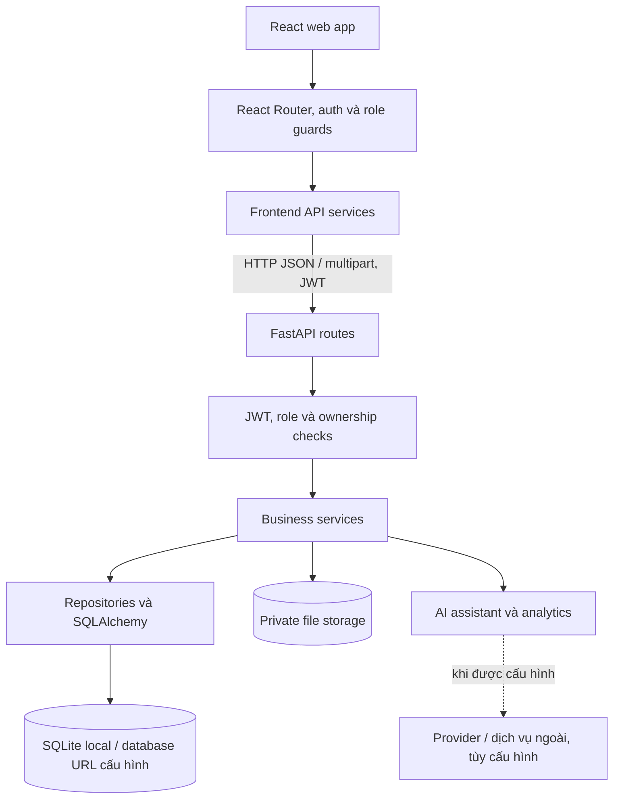

# SportHub AI — Tổng quan và đồng bộ toàn hệ thống

> Cập nhật: **27/10/2026**  
> Phạm vi: toàn bộ sản phẩm SportHub AI trong workspace, không chỉ riêng phân hệ AI.

Tài liệu này là điểm vào chung để hiểu hệ thống hiện có: sản phẩm gồm những phần nào, các phần phối hợp ra sao, dữ liệu và quyền được quản lý thế nào, cũng như những giới hạn cần nêu khi làm báo cáo. Đây là bản tổng quan, không thay thế tài liệu chi tiết của từng phân hệ.

## 1. Sản phẩm

SportHub AI là nền tảng tìm kiếm cơ sở thể thao, đặt sân và hỗ trợ chủ sân vận hành. Hệ thống gồm ứng dụng web React, API FastAPI, cơ sở dữ liệu nghiệp vụ, lưu trữ tệp riêng tư và các chức năng AI/analytics.

Hệ thống có đúng ba vai trò runtime:

| Vai trò | Phạm vi chính |
|---|---|
| `CUSTOMER` | Tìm sân, xem lịch và giá, đặt sân, chọn dịch vụ, thanh toán, xem booking, hóa đơn, hoàn tiền, đánh giá và thông tin của chính mình. |
| `OWNER` | Đăng ký/vận hành cơ sở thuộc mình; quản lý sân, lịch, giá, sản phẩm, booking, khách hàng, thanh toán, bảo trì, khiếu nại, báo cáo và AI insights trong tenant của mình. |
| `SYSTEM_ADMIN` | Quản trị tài khoản và nền tảng; xét duyệt hồ sơ đối tác/cơ sở và xử lý các thao tác quản trị. Không phải vai trò vận hành booking của OWNER. |

Không có vai trò nhân viên `MANAGER`. Việc đăng ký công khai tạo CUSTOMER; việc trở thành OWNER đi qua hồ sơ và phê duyệt.

## 2. Kiến trúc tổng thể

Frontend và backend cùng tham gia bảo vệ luồng truy cập, nhưng backend là nơi quyết định quyền cuối cùng. Các thao tác nghiệp vụ quan trọng được xử lý ở service/backend; frontend không được dùng dữ liệu do client gửi để tự quyết định quyền, giá cuối cùng hoặc tồn kho.

## 3. Thành phần kỹ thuật

| Lớp | Thành phần hiện có |
|---|---|
| Web | React 19, TypeScript, Vite, React Router, Tailwind CSS; Recharts cho biểu đồ. |
| API | Python, FastAPI, Pydantic, SQLAlchemy; các route được đăng ký tại `Backend/app/main.py`. |
| Cơ sở dữ liệu | SQLite được dùng cho môi trường local mặc định; cấu hình kết nối lấy từ environment và có hỗ trợ driver PostgreSQL trong dependencies. |
| AI/analytics | NLU/intent routing, business services, retrieval/knowledge, provider adapter và pipeline dự đoán nhu cầu; một số nhánh cần cấu hình provider hoặc dữ liệu phù hợp. |
| Bảo mật | JWT access/refresh, kiểm tra role/ownership, bcrypt, giới hạn CORS theo cấu hình, kiểm tra upload và audit cho thao tác quan trọng. |
| Khởi tạo dữ liệu | Model SQLAlchemy, các bước migration tương thích schema hiện hữu và demo/catalog seed trong vòng đời backend. |

## 4. Các phân hệ sản phẩm

| Phân hệ | Phạm vi chức năng |
|---|---|
| Khám phá công khai | Trang chủ, danh sách/tìm kiếm cơ sở và sân, lọc, xem chi tiết, lịch/giá khả dụng, đánh giá và gợi ý. |
| Tài khoản và hồ sơ | Đăng ký, đăng nhập, phiên JWT, hồ sơ cá nhân, đổi/khôi phục mật khẩu và ảnh đại diện theo các luồng được cấu hình. |
| Đăng ký đối tác | CUSTOMER gửi và theo dõi hồ sơ OWNER; SYSTEM_ADMIN xem xét; quyền OWNER gắn với quyết định phê duyệt. |
| Quản lý cơ sở | OWNER tạo/cập nhật hồ sơ cơ sở, lưu bản nháp, gửi xét duyệt và quản lý ảnh/tài liệu. Tài liệu xác minh được phục vụ qua luồng có kiểm tra quyền. |
| Sân và lịch | Quản lý sân/field, khung giờ, giá, trạng thái, lịch khóa và bảo trì; kiểm tra khả dụng trước khi nhận booking. |
| Booking | CUSTOMER đặt một hoặc nhiều khung giờ; OWNER quản lý, xác nhận/xử lý booking và các nghiệp vụ phát sinh. Backend kiểm tra xung đột và lưu snapshot thông tin/giá tại thời điểm đặt. |
| Dịch vụ, sản phẩm và kho | OWNER cấu hình sản phẩm/dịch vụ theo cơ sở và môn thể thao; catalog là nguồn gợi ý. Hệ thống quản lý số lượng khả dụng, giữ/trả kho và lịch sử biến động theo loại sản phẩm. |
| Thanh toán và chứng từ | Payment, tiền cọc theo luồng booking, tổng hợp khoản phải trả và invoice/receipt. Sự sẵn có của cổng thanh toán thật phụ thuộc tích hợp và cấu hình môi trường. |
| Hoàn tiền và khiếu nại | Theo dõi yêu cầu hoàn, xác nhận/tranh chấp và xử lý khiếu nại gắn với booking theo quyền tương ứng. |
| Vận hành OWNER | Dashboard, doanh thu/báo cáo, khách hàng, lịch, bảo trì, sản phẩm, thanh toán, đánh giá và quản lý booking. |
| Quản trị nền tảng | Dashboard quản trị, quản lý người dùng, hồ sơ đối tác và xét duyệt/trạng thái cơ sở. |
| Thông báo | Thông báo trong ứng dụng, số chưa đọc và thao tác đánh dấu đã đọc. Email/SMS/push/realtime không nên mô tả là hoàn chỉnh nếu chưa xác minh cấu hình triển khai. |
| AI và analytics | Trợ lý hội thoại, tìm kiếm/gợi ý theo dữ liệu nghiệp vụ, truy xuất tri thức có kiểm soát, cá nhân hóa trong các nhánh hỗ trợ và AI insights/dự đoán nhu cầu. Xem riêng mục 7. |

Frontend route khai báo trong `Frontend/src/routes/AppRouter.tsx`; API được chia trong `Backend/app/api/routes/`. Các module nghiệp vụ chính có service, schema, repository/model tương ứng khi cần.

## 5. Luồng nghiệp vụ và dữ liệu

### 5.1 Đăng ký và duyệt cơ sở

CUSTOMER gửi hồ sơ đối tác → SYSTEM_ADMIN xét duyệt hồ sơ đối tác → tài khoản được cấp quyền OWNER khi đủ điều kiện → OWNER tạo cơ sở ở trạng thái nháp và gửi xét duyệt → cơ sở được duyệt mới tham gia các luồng công khai/vận hành theo trạng thái hiện hành.

Trạng thái cơ sở được dùng trong workflow gồm `DRAFT`, `PENDING_APPROVAL`, `APPROVED`, `REJECTED` và `SUSPENDED`.

### 5.2 Booking, sản phẩm và thanh toán

CUSTOMER chọn sân/ngày/khung giờ và có thể chọn dịch vụ → backend kiểm tra khả dụng, quyền, giá và tồn kho từ dữ liệu server → tạo booking và lưu các dòng snapshot → payment được ghi nhận theo trạng thái booking → khi booking bị hủy/hết hạn, các tài nguyên được giải phóng theo quy tắc nghiệp vụ.

Các thực thể dữ liệu trọng tâm gồm `User`, `OwnerApplication`, `Facility`, `Field`, `TimeSlot`, `Booking`, `BookingSlot`, `BookingProductItem`, `Payment`, `Invoice`, `RefundRequest`, `FacilityProduct`, `ProductCatalogItem`, `ProductStockMovement`, `Notification`, `Review`, `FieldMaintenance`, `FieldBlock`, `AuditLog` và dữ liệu hội thoại/knowledge của AI. Chi tiết bảng và quan hệ nằm trong `CSDL.md`.

### 5.3 Quyền và ranh giới dữ liệu

- CUSTOMER chỉ được đọc/thay đổi tài nguyên cá nhân trong phạm vi cho phép.
- OWNER được giới hạn theo cơ sở thuộc tài khoản hiện tại; backend lấy phạm vi sở hữu từ danh tính đã xác thực.
- SYSTEM_ADMIN có quyền quản trị được khai báo ở backend; quyền này không đồng nghĩa quyền thao tác thay OWNER trong nghiệp vụ hằng ngày.
- Endpoint công khai chỉ trả dữ liệu được phép công khai. Tệp hồ sơ riêng tư cần qua endpoint kiểm tra quyền.
- Giá, availability và tồn kho có thẩm quyền từ backend/database. AI có thể hỗ trợ giải thích/gợi ý nhưng không tự tạo booking hoặc payment.

## 6. Backend và frontend ở mức module

### Backend

- `api/routes/`: endpoint cho auth, admin, facilities, fields, time slots, public courts, bookings, payments, refunds, products, operations, maintenance, dashboard, notifications, reviews và AI.
- `services/`: quy tắc nghiệp vụ như booking, availability, inventory, payment, refund, facility files, notification, dashboard, AI và knowledge retrieval.
- `repositories/`: truy vấn dữ liệu được dùng chung bởi service.
- `models/` và `schemas/`: entity SQLAlchemy và hợp đồng request/response Pydantic.
- `core/`: cấu hình, security, ownership và tiện ích chung.
- `database/`: session/engine, migration tương thích và seed.
- `ai/`: training, inference, preprocessing, evaluation và artifact của pipeline dự đoán.

### Frontend

- `routes/`, `layouts/`, `contexts/` và `components/auth/`: điều hướng, bố cục, auth state và route guards.
- `pages/`: trang public, CUSTOMER, OWNER/management, SYSTEM_ADMIN và AI assistant.
- `services/`: client gọi API và các wrapper theo phân hệ.
- `components/`: giao diện dùng chung, booking, sân, sản phẩm, payment, notification và AI.
- Một số trang/tiện ích có thể còn placeholder hoặc dữ liệu giả lập; không suy ra mọi thành phần giao diện đều nối API thật chỉ từ cấu trúc thư mục.

## 7. Phân hệ AI

AI là một phân hệ của SportHub AI, không phải toàn bộ hệ thống. Nó kết hợp intent/context processing, policy, service/repository nghiệp vụ, truy xuất tri thức, provider bên ngoài tùy cấu hình và analytics/demand prediction. Nhánh nghiệp vụ lấy giá, lịch, booking và thông tin cá nhân từ backend với xác thực/phạm vi quyền thích hợp. LLM không được xem là nguồn dữ liệu chuẩn cho nghiệp vụ giao dịch và không trực tiếp ghi booking/payment.

Trợ lý có các mode/policy và luồng retrieval khác nhau; các nguồn Sports Knowledge, web retrieval, memory và hồ sơ cá nhân có điều kiện sử dụng riêng. Chi tiết runtime, mode, kiểm thử và các điểm lịch sử được ghi trong tài liệu AI được liệt kê ở mục 9; không lấy số liệu/provider từ checkpoint lịch sử làm trạng thái hiện tại nếu chưa đối chiếu code/cấu hình mới nhất.

## 8. Giới hạn và trạng thái cần trình bày chính xác

- `Frontend/src/components/venue/MapMock.tsx` là bản đồ mô phỏng, chưa phải tích hợp bản đồ trực tuyến hoàn chỉnh.
- Email/SMS/push/realtime và cổng thanh toán ngân hàng thật phụ thuộc tích hợp, cấu hình và môi trường triển khai; phân biệt rõ luồng demo với dịch vụ production.
- AI provider ngoài phụ thuộc secret/cấu hình môi trường; cần mô tả fallback và khả năng hoạt động theo đúng nhánh đang kiểm tra.
- Sự hiện diện của trang hoặc API không tự chứng minh toàn bộ quy trình đã nghiệm thu. Báo cáo nên chỉ gọi chức năng “hoàn thành” khi đã đối chiếu code, quyền, giao diện và bằng chứng kiểm thử phù hợp.
- Tài liệu mô tả là snapshot có ngày cập nhật. Khi khác với source hiện hành, dùng code runtime làm căn cứ và cập nhật lại tài liệu chi tiết có liên quan.

## 9. Bản đồ tài liệu

| Cần tìm hiểu | Tài liệu |
|---|---|
| Dàn ý báo cáo đồ án | [`REPORT_GUIDE.md`](REPORT_GUIDE.md) |
| Kiến trúc kỹ thuật frontend/backend và luồng dữ liệu | [`ARCHITECTURE.md`](ARCHITECTURE.md) |
| Cây chức năng và phạm vi vai trò | [`FUNCTIONAL_HIERARCHY.md`](FUNCTIONAL_HIERARCHY.md), [`Chucnang.md`](Chucnang.md), [`ROLE_MODEL.md`](ROLE_MODEL.md) |
| Cơ sở dữ liệu, bảng và quan hệ | [`CSDL.md`](CSDL.md) |
| Endpoint và hợp đồng API | [`API.md`](API.md) |
| AI assistant — kiến trúc và trạng thái hiện hành | [`AI/AI_ARCHITECTURE.md`](AI/AI_ARCHITECTURE.md), [`AI_ASSISTANT_ARCHITECTURE_REPORT.md`](AI_ASSISTANT_ARCHITECTURE_REPORT.md) |
| AI — báo cáo tổng hợp và đánh giá | [`AI_SYSTEM.md`](AI_SYSTEM.md), [`AI_EVALUATION.md`](AI_EVALUATION.md) |
| Cây mã nguồn và module quan trọng | [`PROJECT_TREE.md`](PROJECT_TREE.md) |
| Hướng dẫn chạy dự án | [`../README.md`](../README.md), [`../Backend/README.md`](../Backend/README.md), [`../Frontend/README.md`](../Frontend/README.md) |

Trong `AI_SYSTEM.md`, mục “Các báo cáo AI trước đây — lưu làm lịch sử” và trong `AI_ASSISTANT_ARCHITECTURE_REPORT.md`, mục “Nội dung báo cáo checkpoint cũ” là ghi nhận theo các mốc trước đó; số liệu ở đó không mặc nhiên phản ánh runtime hiện tại. Để mô tả kiến trúc assistant, đối chiếu `AI/AI_ARCHITECTURE.md` và phần “Hiện trạng đã đối chiếu source” trong `AI_ASSISTANT_ARCHITECTURE_REPORT.md`. Khi trích dẫn kết quả đánh giá ở `AI_EVALUATION.md`, ghi rõ ngày và phạm vi lần chạy tương ứng.
